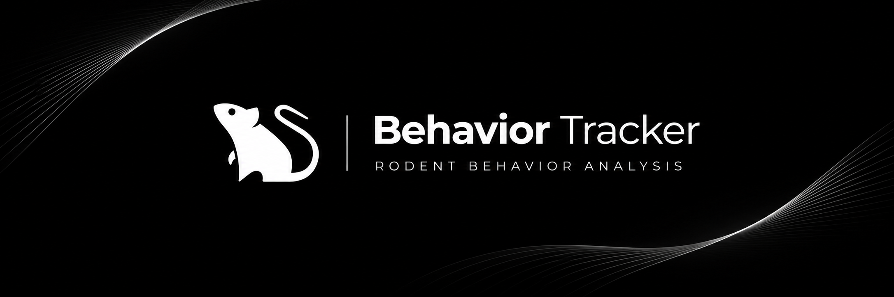
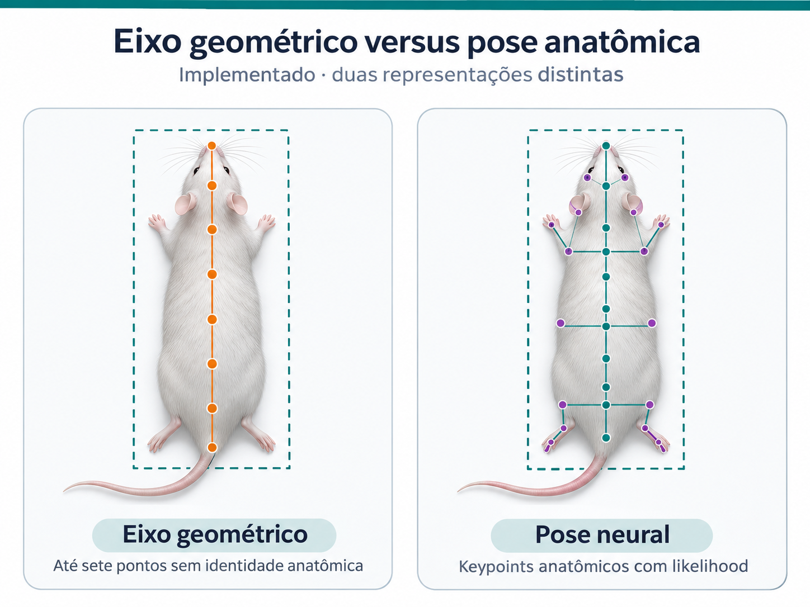
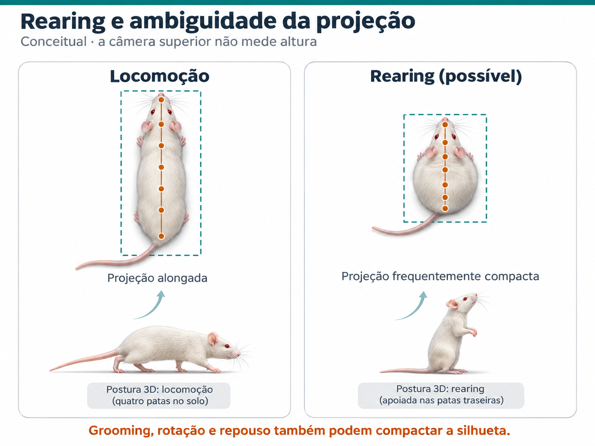
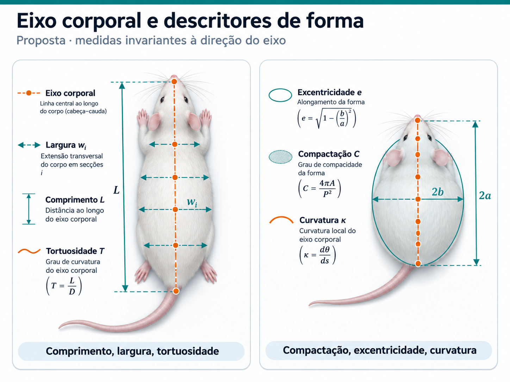
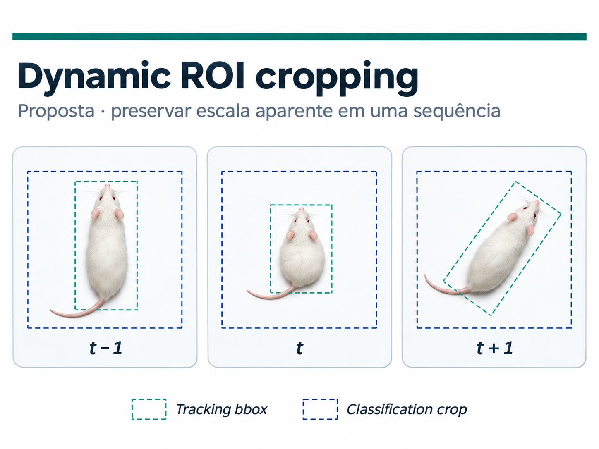
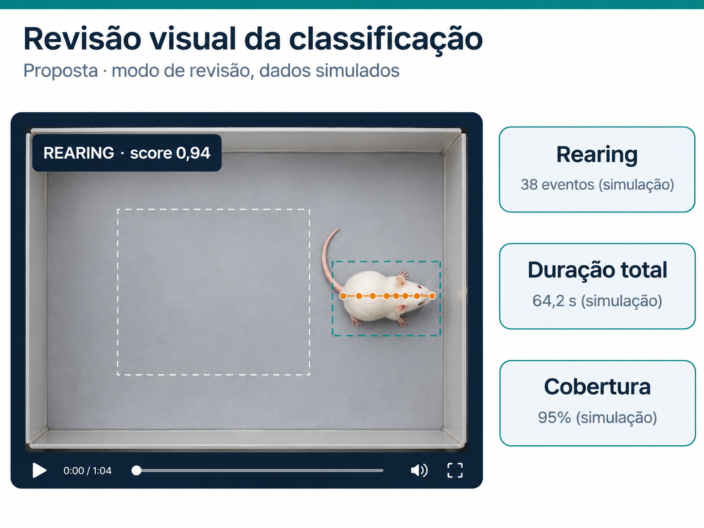

  

<h1 align="center">Behavior Tracker</h1>

<strong>Computational neuroethology · Markerless tracking · Quantitative behavioral analysis</strong>

Plataforma de análise de experimentos comportamentais em roedores, com processamento local em CPU e inferência neural opcional no Google Colab.

  <a href="https://github.com/CodesOfGabriel/behaviortracker/releases">Downloads</a> ·
  <a href="#protocolos-experimentais">Protocolos</a> ·
  <a href="#fundamentação-matemática">Metodologia</a> ·
  <a href="#rearing-top-down--linha-de-desenvolvimento">Pesquisa em rearing</a> ·
  <a href="#referências">Referências</a>

> **Estado científico:** software de pesquisa em desenvolvimento. Os pipelines de tracking e os indicadores descritos abaixo estão implementados em diferentes níveis de maturidade. A classificação automática de rearing por CNN/TCN é uma linha de desenvolvimento proposta, não uma funcionalidade disponível ou validada. Não utilizar estimativas experimentais como substitutas de medidas revisadas sem validação no protocolo de interesse.

## Visão geral

A análise de ensaios comportamentais em neurociências frequentemente exige horas de inspeção de vídeo, anotação manual e revisão de eventos. A variabilidade interobservador, as diferenças de iluminação, reflexos, oclusões e configurações de câmera tornam a padronização de medidas um desafio metodológico.

O **Behavior Tracker** integra técnicas de visão computacional, processamento de sinais e estimativa de pose sem marcadores (*markerless pose estimation*) em uma aplicação desktop destinada a pesquisadores. A proposta é reduzir barreiras computacionais e operacionais, preservando o acesso aos dados brutos, o controle de qualidade e a possibilidade de revisão humana.

A aplicação separa três problemas: **localização do animal**, **representação da postura** e **interpretação do comportamento**. Um resultado de tracking, mesmo visualmente plausível, não é automaticamente uma classificação comportamental ou uma medida anatômica válida.

Desenvolvido por **Gabriel Santos** e **Thiago Vargas**, em parceria entre o **Laboratório Neurocell** e o **NeuroLab da Universidade Federal de Pelotas (UFPel)**.

## Protocolos experimentais

*Figura 1. Configuração conceitual dos protocolos. Os desenhos não representam dimensões obrigatórias de aparatos.*

| Protocolo | Processamento local | Processamento neural | Indicadores e limites atuais |
|---|---|---|---|
| **Open Field Test (OFT)** | OpenCV: silhueta, caixas, trajetória; Wistar + HRNet como alternativa | Detector Wistar + HRNet-W32, 27 pontos, local ou Colab | Distância, velocidade, centro/periferia, entradas, imobilidade operacional e cobertura, conforme elegibilidade. Rearing automático ainda não validado. |
| **Forced Swim Test (FST)** | Presença e características de movimento por cilindro | SuperAnimal Quadruped, HRNet-W32, 39 pontos, Colab | Presença, movimento relativo, alteração de silhueta e cobertura anatômica. Imobilidade, natação e escalada permanecem `NOT_CLASSIFIED` até anotação humana. |
| **Radial Arm Maze (RAM)** | Tracking clássico ou RAM Color experimental | Wistar + HRNet experimental no Colab | Localização, trajetória, revisão e geometria dos potes. Escolhas, erros de memória e consumo não são inferências automáticas validadas. |

### Campo aberto

O OFT investiga dimensões da atividade locomotora e do padrão de exploração espacial. O pesquisador define os quatro cantos do piso, a borda superior, as dimensões em centímetros e a fração central da arena. A borda delimita o contexto visual; a homografia do piso é utilizada para a conversão espacial. A postura ereta e as projeções na parede podem violar a hipótese de movimento no plano calibrado.

O tempo no centro, a exploração periférica e a atividade locomotora são indicadores dependentes de espécie, linhagem, idade, condições ambientais e desenho experimental. Isoladamente não constituem diagnóstico de ansiedade ou de outro estado afetivo.

### Nado forçado

A análise acompanha um ou dois sujeitos, cada qual associado a uma ROI fixa do cilindro. A presença visual é determinada independentemente da disponibilidade dos pontos anatômicos. O modo neural utiliza caixas corporais por frame para contextualizar a estimativa HRNet. O sistema preserva intervalos incertos em vez de interpretá-los como ausência, imobilidade ou outro comportamento.

Consultar o [contrato FST](docs/FST_CONTRACT.md). A análise de atividade não permite, isoladamente, inferir um estado depressivo.

### Labirinto radial

A preparação permite delimitar a área transitável, oito potes e quatro recompensas. O motor de eventos existente para geometrias com braços e linhas definidos distingue visitas iniciais e revisitas. Entretanto, um contorno único não é suficiente para estabelecer esses eventos. A trajetória atual não constitui prova de escolha ou consumo; proximidade ao pote não confirma ingestão.

Consultar o [contrato RAM](docs/RAM_CONTRACT.md).

## Instalação e fluxo de trabalho

1. Baixe o instalador correspondente ao sistema em [GitHub Releases](https://github.com/CodesOfGabriel/behaviortracker/releases), quando disponível. Os bundles de pesos não são instaladores. Windows x64, macOS Intel/Apple Silicon e Linux x64 possuem formatos de distribuição próprios.
2. Crie um experimento, identifique sujeito(s), protocolo e vídeo original.
3. Defina a geometria correspondente: piso e borda no OFT, cilindro(s) no FST ou área transitável e potes no RAM.
4. Escolha a análise local ou, quando aplicável, conecte a conta Google e selecione o Colab. A execução local não exige autenticação Google; a remota exige autorização e runtime compatível com CUDA.
5. Confira os resultados, a cobertura, o vídeo de auditoria e os intervalos com evidência insuficiente. Selecione a execução que pretende interpretar.
6. Exporte os dados brutos, revisões, métricas e manifestos. Preserve também o vídeo original.

O modo **OpenCV rápido · CPU** não depende de download de pesos neurais. O modo Wistar local instala um ambiente Python isolado sob demanda. FFmpeg e FFprobe são distribuídos com os instaladores. O fluxo de preparação remota pode criar cópia H.264 sem áudio, limitada a 1080p para vídeos grandes, verificando o alinhamento de frames e tempos antes do envio. Se a otimização não for adequada, o original é utilizado. O aplicativo não sincroniza experimentos entre computadores.

## Arquitetura computacional

### 1. Tracking clássico local

A estratégia `classical_roi_v1` (`opencv-box-9` na revisão documentada) realiza segmentação sem rede neural. O FFmpeg decodifica o vídeo, normalmente em largura de 640 px (480 e 960 px também disponíveis), e o FFprobe fornece os timestamps de apresentação (PTS). Até 31 amostras distribuídas pela sessão formam uma referência de fundo por mediana temporal. Essa referência permanece fixa, reduzindo a incorporação posterior de animais imóveis ao fundo.

O motor limita o processamento à ROI, combina luminância e cromaticidade Lab, limiares robustos, operações morfológicas e seleção de componentes candidatos. A associação utiliza posição, aparência, área, preenchimento, relação com o piso e continuidade. O filtro de Kalman estima posição em perdas curtas, enquanto fluxo óptico Lucas–Kanade bidirecional auxilia a associação visual. Predições e recuperações não equivalem a observações confirmadas.

As caixas e os contornos retornam às coordenadas originais. O descritor `silhouette-features-1` registra área, aspect ratio, extent, eixo principal, movimento do centroide da máscara e diferenças temporais. Os arquivos `samples.jsonl` e `motion_features.jsonl` preservam os resultados por frame. A qualidade do tracking e a adequação geométrica para medidas no piso são dimensões independentes.

### 2. Tracking neural e estimativa de pose

O detector Faster R-CNN com backbone ResNet-50 FPN v2 identifica o animal (classe animal e fundo) e fornece caixas com contexto espacial à HRNet-W32. A estimativa de pose utiliza DeepLabCut 3.0.2 e o bundle Wistar, com 27 pontos nomeados e likelihood por ponto. A versão v2 adiciona critérios de ROI, piso e continuidade à seleção de caixas. O pipeline compartilhado preserva poses brutas e exporta uma variante filtrada F+C (mediana temporal de cinco amostras, condicionada à confiança e disponibilidade). A pose canônica não deve ser confundida com a saída filtrada.

O modo local pode executar em CPU ou NVIDIA CUDA compatível; o remoto utiliza GPU CUDA do Colab, com comunicação MCP e monitoramento de workers. A correspondência de frames é verificada. O pipeline neural exporta tempo nominal por frame/FPS da entrada; o alinhamento com o relógio original deve ser verificado especialmente em vídeo VFR. O fluxo clássico local mantém os PTS originais.

### 3. Eixo geométrico e skeleton anatômico

*Figura 2. A linha de até sete pontos é uma aproximação da silhueta, não um mapa de articulações. Os pontos da pose neural são ilustrativos, não uma reprodução exata dos 27 pontos do modelo.*

O modo rápido calcula o eixo principal da máscara e centros de seções transversais. A renderização pode ponderar os centros pela distância ao fundo. Silhuetas aproximadamente circulares podem manter a direção visual anterior, quando há continuidade. Os extremos não identificam necessariamente cabeça e cauda. Uma caixa prevista sem contorno não recebe um skeleton inventado.

O gráfico do MP4 clássico representa velocidade do centro da caixa em pixels por segundo, numa janela de dez segundos; não representa automaticamente velocidade no piso em centímetros por segundo. A renderização é derivada dos dados armazenados e pode ser refeita sem novo tracking.

## Fundamentação matemática

### Notação e relógio

Considere o frame $I_i$, seu timestamp de apresentação $t_i$, a máscara binária $M_i$, a bounding box $B_i$, e a função indicadora de elegibilidade $q_i$. As fórmulas desta seção descrevem os indicadores atuais ou sua base matemática, com as extensões futuras identificadas explicitamente na seção de rearing.

### Referência de fundo e segmentação

Para um conjunto de $K$ amostras temporais, a referência de fundo conceitual é:

$$B(x,y)=\operatorname{median}_{k=1}^{K} I_{s_k}(x,y),\qquad K\leq31$$

Uma máscara de diferença simplificada é:

$$M_i(x,y)=\mathbb{1}\big[\rho(I_i(x,y),B(x,y))>\tau(x,y)\big]\,R(x,y)$$

onde $R$ é a máscara da região de interesse e $\rho$ representa diferenças de luminância/crominância. O motor real combina limiares robustos, morfologia e critérios de associação; a expressão não pretende reproduzir integralmente seu código.

Área projetada, centroide da máscara e preenchimento da caixa:

$$A_i=\sum_{x,y}M_i(x,y)$$

$$\boldsymbol{c}_i=\frac{1}{A_i}\sum_{x,y}M_i(x,y)\begin{bmatrix}x\\y\end{bmatrix},\qquad E_i=\frac{A_i}{w_i h_i}$$

As coordenadas podem ser reconvertidas à resolução original; áreas variam com o quadrado do fator de escala.

### Eixo principal da silhueta

$$\Sigma_i=\frac{1}{A_i}\sum_{\boldsymbol{p}\in M_i}(\boldsymbol{p}-\boldsymbol{c}_i)(\boldsymbol{p}-\boldsymbol{c}_i)^\top$$

$$\Sigma_i\boldsymbol{v}_1=\lambda_1\boldsymbol{v}_1,\qquad \lambda_1\geq\lambda_2$$

O primeiro autovetor define um eixo sem orientação anatômica. Uma representação equivalente, com momentos centrais da máscara, é:

$$\theta_i=\frac{1}{2}\operatorname{atan2}(2\mu_{11},\mu_{20}-\mu_{02})$$

### Continuidade temporal: Kalman e fluxo óptico

O filtro de Kalman para um estado de posição/velocidade $\boldsymbol{x}=[x,y,v_x,v_y]^\top$ segue, conceitualmente:

$$\hat{\boldsymbol{x}}^-_i=F_i\hat{\boldsymbol{x}}_{i-1},\qquad P_i^-=F_iP_{i-1}F_i^\top+Q_i$$

$$K_i=P_i^-H_o^\top(H_oP_i^-H_o^\top+R_i)^{-1}$$

$$\hat{\boldsymbol{x}}_i=\hat{\boldsymbol{x}}^-_i+K_i(\boldsymbol{z}_i-H_o\hat{\boldsymbol{x}}^-_i)$$

$H_o$ é a matriz de observação, $Q_i$ e $R_i$ são covariâncias de ruído. A atualização depende de uma observação aceita pelo rastreador; uma previsão não confirma identidade nem postura.

A hipótese clássica de constância de brilho subjacente ao fluxo óptico é:

$$I_x u+I_y v+I_t\approx0$$

A verificação bidirecional testa a consistência de uma correspondência de imagem em ambos os sentidos. O fluxo, isoladamente, não confirma uma nova observação do animal.

### Calibração espacial e trajetória do OFT

A transformação homográfica $H$ leva coordenadas de imagem a coordenadas no piso:

$$\begin{bmatrix}u\\v\\w\end{bmatrix}=H\begin{bmatrix}x\\y\\1\end{bmatrix},\qquad \boldsymbol{r}_i=\left(\frac{u}{w},\frac{v}{w}\right)$$

Para o cálculo, a referência pode ser um ponto revisado ou, numa política de estimativa separada, o centro de caixas observadas elegíveis. Define-se o par elegível $g_i=1$ quando os frames são consecutivos, as duas posições são válidas no piso e $0<t_{i+1}-t_i\leq0{,}5\,\mathrm{s}$; caso contrário $g_i=0$.

$$D=\sum_i g_i\|\boldsymbol{r}_{i+1}-\boldsymbol{r}_i\|_2$$

$$T_v=\sum_i g_i(t_{i+1}-t_i),\qquad \bar{v}=\frac{D}{T_v}$$

$$v_i=\frac{\|\boldsymbol{r}_{i+1}-\boldsymbol{r}_i\|_2}{t_{i+1}-t_i}\quad(g_i=1)$$

Não há soma de deslocamento entre os extremos de uma lacuna desconhecida. Ausência de pares elegíveis torna distância e velocidade não mensuráveis, não iguais a zero.

Para uma fração central de área $f$ e arena retangular de largura $W$ e comprimento $L$, um centro retangular proporcional tem dimensões $W\sqrt{f}$ e $L\sqrt{f}$ (quando essa geometria é a escolhida). O tempo central e periférico são:

$$T_C=\sum_i g_i\mathbb{1}[\boldsymbol{r}_i\in C]\Delta t_i,\qquad T_P=\sum_i g_i\mathbb{1}[\boldsymbol{r}_i\notin C]\Delta t_i$$

$$T_{\mathrm{unknown}}=T_{\mathrm{analysis}}-(T_C+T_P)$$

$$\%C=100\frac{T_C}{T_C+T_P},\qquad \mathrm{Coverage}=100\frac{T_C+T_P}{T_{\mathrm{analysis}}}$$

As entradas no centro exigem transição observada da periferia e permanência mínima configurada (0,2 s na política documentada). A imobilidade operacional corresponde a intervalos contínuos com velocidade abaixo do limiar configurado e duração mínima; não equivale automaticamente a freezing ou imobilidade etológica.

### Descritores de movimento

Para máscaras consecutivas no mesmo sistema de coordenadas, a fração de pixels alterados é a diferença simétrica normalizada:

$$J_\Delta=\frac{|M_i\triangle M_{i-1}|}{|M_i\cup M_{i-1}|}$$

A diferença média de intensidade é:

$$\mathrm{MAD}_i=\frac{1}{|U|}\sum_{p\in U}|I_i(p)-I_{i-1}(p)|,\qquad U=M_i\cup M_{i-1}$$

Esses indicadores são sensíveis à iluminação, à qualidade da segmentação e ao deslocamento global. São proxies de movimento visual, não labels comportamentais.

## Controle de qualidade e evidência disponível

| Indicador DD2 (7.356 frames) | v8 | v9 |
|---|---:|---:|
| Localizações aceitas pelo tracking | 24,59% | 81,92% |
| Observações sem alertas | 3,11% | 8,90% |
| Velocidade do motor, sem renderização | 162,6 FPS | 80,5 FPS |

O aumento da aceitação não demonstra aumento da acurácia. Na execução v9, a política de estimativa no piso utilizou somente 23,54 s de aproximadamente 306,46 s (7,68%). A referência revisada permaneceu sem pares elegíveis. Os números não sustentam conclusões biológicas sobre a sessão inteira. O DD2 foi utilizado durante o desenvolvimento; não é um teste independente. Consultar os [relatórios de tracking](docs/reports/benchmark-dd2-reflections-2026-11-24.json) e de [métricas geométricas](docs/local-floor-box-metrics.md).

A política `oft-0.2` preserva a referência revisada. A alternativa `oft-floor-box-estimate-1` identifica explicitamente estimativas de centro de caixa no piso, sem promover `referenceApproved` ou alterar os dados originais.

---

## Rearing top-down — linha de desenvolvimento

> **Proposta de pesquisa (não implementada/validada):** classificador supervisionado visual-temporal, destinado a funcionar em CPU com uma única câmera superior. As figuras seguintes ilustram a metodologia planejada, não resultados de inferência ou telas existentes.

O rearing é uma forma de exploração vertical em que o animal eleva a região anterior do corpo, sustentado predominantemente pelos membros posteriores. Pode ocorrer com apoio externo (*supported rearing*) ou sem apoio (*unsupported rearing*). A definição deve ser operacionalizada no protocolo de anotação.

*Figura 3. A projeção bidimensional pode se tornar mais compacta durante rearing, mas esse sinal não é específico.*

Uma câmera superior não fornece diretamente a coordenada vertical $Z$. A diferença de posição entre cabeça e base da cauda no eixo $y$ da imagem não é altura física. O skeleton geométrico, por si só, não pode resolver a sobreposição anatômica ou confirmar contato das patas com uma parede. A hipótese de pesquisa é que a combinação de aparência, morfologia e dinâmica permite inferir o comportamento quando visualmente observável, mantendo uma classe de incerteza.

### Arquitetura proposta

O tracking fornece uma ROI dinâmica. A classificação utiliza crops RGB do vídeo original, descritores de forma e movimento, e contexto temporal. Um classificador separado preserva o rastreador existente e evita dependência obrigatória do DeepLabCut. A pose neural poderá ser avaliada como modalidade adicional, não como requisito.

### Descritores geométricos propostos

*Figura 4. Medidas projetadas do contorno e do eixo sem identidade anatômica.*

Sejam $A$ a área da máscara, $P$ seu perímetro, $a\geq b$ os semieixos de uma elipse ajustada e $A_h$ a área da envoltória convexa:

$$\mathrm{Circularity}=\frac{4\pi A}{P^2}$$

$$\mathrm{Eccentricity}=\sqrt{1-\frac{b^2}{a^2}}$$

$$\mathrm{Solidity}=\frac{A}{A_h},\qquad \mathrm{AspectRatio}_{\mathrm{oriented}}=\frac{a}{b}$$

Para os pontos da linha central $\boldsymbol{p}_1,\ldots,\boldsymbol{p}_N$:

$$L=\sum_{j=1}^{N-1}\|\boldsymbol{p}_{j+1}-\boldsymbol{p}_j\|_2$$

$$\mathrm{Tortuosity}=\frac{L}{\|\boldsymbol{p}_N-\boldsymbol{p}_1\|_2+\varepsilon}$$

$$\Delta L_t=\frac{L_t-L_{t-k}}{L_{\mathrm{ref}}+\varepsilon},\qquad \Delta A_t=\frac{A_t-A_{t-k}}{A_{\mathrm{ref}}+\varepsilon}$$

Uma curvatura discreta auxiliar pode ser calculada pelo ângulo absoluto entre segmentos consecutivos, com normalização pelo comprimento de arco:

$$\kappa_j=\frac{\arccos\!\left(\operatorname{clip}\frac{\boldsymbol{d}_{j-1}\cdot\boldsymbol{d}_j}{\|\boldsymbol{d}_{j-1}\|\|\boldsymbol{d}_j\|+\varepsilon},-1,1\right)}{(\|\boldsymbol{d}_{j-1}\|+\|\boldsymbol{d}_j\|)/2+\varepsilon}$$

onde $\boldsymbol{d}_j=\boldsymbol{p}_{j+1}-\boldsymbol{p}_j$. Medidas degeneradas devem ficar ausentes, com máscara de validade. Perfis de largura devem ser invariantes à inversão do eixo, por exemplo mediante estatísticas simétricas.

### Movimento interno

*Figura 5. O deslocamento do centroide não é suficiente para identificar atividade postural.*

Para o fluxo óptico $\boldsymbol{u}_i(p)$ na região corporal, a translação mediana pode ser removida como aproximação de movimento global:

$$\boldsymbol{m}_i=\operatorname{median}_{p\in M_i}\boldsymbol{u}_i(p),\qquad \boldsymbol{u}'_i(p)=\boldsymbol{u}_i(p)-\boldsymbol{m}_i$$

$$V_{\mathrm{internal},i}=\frac{1}{|M_i|\Delta t_i}\sum_{p\in M_i}\|\boldsymbol{u}'_i(p)\|_2$$

Esse resíduo não representa diretamente movimento vertical. É uma variável projetada, afetada por rotação e erros de correspondência. Testar fluxo esparso Lucas–Kanade e fluxo denso Farnebäck em crops reduzidos, sem exigir fluxo denso no vídeo inteiro.

### Recorte dinâmico e escala espacial

*Figura 6. O centro do crop acompanha a caixa, mas a escala de referência deve permanecer estável.*

A bbox determina a região a observar; o crop é quadrado, com margem e escala de referência por sessão. Redimensionar cada bbox para preencher todo o input pode apagar informações de variação aparente de tamanho. Configuração inicial: 128 × 128 RGB, margem de aproximadamente 30%, fator de escala de referência 1,6 e frequência de inferência de 15 Hz. Esses valores são hiperparâmetros a comparar na validação.

A segunda passagem decodifica sequencialmente o original e utiliza caixas e PTS do tracking concluído. A geometria do piso não deve vetar observações comportamentais válidas perto das paredes. Ambiguidade, reflexos, identidade incerta e caixas apenas previstas exigem QC separado.

### Encoder visual e classificador temporal

$$\boldsymbol{e}_t=f_\theta(\operatorname{crop}(I_t,B_t))\in\mathbb{R}^{128}$$

$$\boldsymbol{z}_t=[\boldsymbol{e}_t;\boldsymbol{s}_t;\boldsymbol{m}_t;\boldsymbol{q}_t]$$

onde $\boldsymbol{s}_t$ agrega descritores geométricos, $\boldsymbol{m}_t$ descritores de movimento e $\boldsymbol{q}_t$ máscaras de validade. Cada embedding deve ser calculado uma única vez e reutilizado nas janelas temporais. A normalização usa estatísticas do treinamento ou calibração por sessão previamente definida.

Uma convolução temporal dilatada de kernel ímpar $k$ e dilatação $d$ é:

$$h_t^{(l)}=\phi\left(\sum_{j=-(k-1)/2}^{(k-1)/2}W_j^{(l)}h_{t+jd}^{(l-1)}+b^{(l)}\right)$$

Para uma convolução por bloco, stride 1, $k=3$ e dilatações $1,2,4,8$, o campo receptivo é:

$$R=1+(k-1)\sum_l d_l=1+2(1+2+4+8)=31$$

A 15 Hz, 31 amostras abrangem aproximadamente 2 s entre a primeira e a última. Como o processamento é offline, o contexto pode incluir observações futuras, respeitando limites de sessão e máscaras de validade.

A cabeça principal estima um score de rearing, e a cabeça auxiliar distingue apoio somente quando observável:

$$p_t=\sigma(g_\psi(\boldsymbol{z}_{t-15:t+15})),\qquad \boldsymbol{p}_{\mathrm{support}|R}=\operatorname{softmax}(\boldsymbol{\ell}_t)$$

Treinamento supervisionado com perda binária ponderada e perda condicional de subtipo:

$$\mathcal{L}=\mathcal{L}_{\mathrm{BCE}}^{\mathrm{masked}}+\lambda\mathcal{L}_{\mathrm{support}}^{\mathrm{masked}}$$

Trechos ambíguos devem ser mascarados conforme o contrato de anotação. Scores somente são interpretados como probabilidades calibradas após avaliação específica.

### Decodificação dos episódios

$$\hat{y}_t=\begin{cases}1,&p_t\geq\tau_{\mathrm{on}}\\0,&p_t<\tau_{\mathrm{off}}\\\hat{y}_{t-1},&\text{caso contrário}\end{cases},\qquad \tau_{\mathrm{on}}>\tau_{\mathrm{off}}$$

A histerese conceitual deve ser complementada por duração mínima, confirmação temporal e máscaras de qualidade. Lacunas desconhecidas não se tornam automaticamente positivas ou negativas. Trechos com retorno confirmado à postura quadrúpede separam episódios.

| Parâmetro de piloto | Valor inicial, não validado |
|---|---:|
| Limiar de início | 0,75 |
| Limiar de término | 0,40 |
| Duração mínima | 0,20 s |
| Confirmação de início/término | 0,13 s |
| Lacuna máxima a avaliar | 0,15 s |

A resolução temporal nominal da inferência a 15 Hz é 66,7 ms. O resultado deve mapear cada previsão aos PTS reais e registrar o suporte temporal. Não substituir os timestamps por frame/FPS em vídeos VFR.

### Classes e anotação humana

*Figura 7. Comportamentos negativos visualmente semelhantes e situações que podem exigir a classe desconhecida.*

| Classe proposta | Definição |
|---|---|
| `REARING_SUPPORTED` | Elevação com apoio das patas anteriores identificável na gravação |
| `REARING_UNSUPPORTED` | Elevação sem apoio externo identificável |
| `REARING_UNSPECIFIED` | Elevação observável, tipo de apoio indeterminado |
| `NON_REARING` | Postura sem rearing claramente observável |
| `UNKNOWN` | Evidência visual insuficiente |

Grooming, rotação, investigação da parede em quadrupedia, repouso e reflexos devem integrar os exemplos difíceis. A proximidade da parede é contexto, não prova de apoio. Nenhum sensor ou câmera lateral é necessário para a proposta, mas a observabilidade de alguns episódios será limitada e a referência humana top-down compartilha essa limitação.

O dataset deverá armazenar `video_id`, `animal_id`, `session_id`, `arena_id`, SHA-256 do vídeo, início e fim do intervalo, classe e anotador. Revisores independentes devem anotar vídeos completos ou indicar explicitamente quais trechos foram revisados. Intervalos não anotados não equivalem a negativos.

### Métricas comportamentais propostas

Para episódios observados $[s_j,e_j)$, com duração mensurável $d_j=e_j-s_j$ descontando lacunas desconhecidas quando aplicável:

$$N_R=\#\{j:\mathrm{episode}_j\},\qquad T_R=\sum_{j=1}^{N_R}d_j$$

$$\bar{d}_R=\frac{T_R}{N_R},\qquad f_R=60\frac{N_R}{T_{\mathrm{classifiable}}}$$

$$\%R=100\frac{T_R}{T_{\mathrm{classifiable}}},\qquad \mathrm{Coverage}=100\frac{T_{\mathrm{classifiable}}}{T_{\mathrm{analysis}}}$$

A latência é o início do primeiro episódio observado em relação ao início da análise, condicionada à observabilidade do trecho precedente. Com lacunas iniciais, a latência exata pode não ser mensurável. Contagem zero exige observação suficiente; sem cobertura, retornar não mensurável. Métricas automáticas e revisadas permanecem distintas.

*Figura 8. Mockup com dados fictícios. Não representa uma tela já implementada nem resultados experimentais.*

### Treinamento, exportação e avaliação

A pesquisa deve comparar, com os mesmos splits por animal e sessão:

| Variante | Modalidades | Objetivo |
|---|---|---|
| A | Silhueta + movimento + Random Forest | Baseline leve |
| B | MobileNetV3-Small | Efeito da aparência sem temporalidade |
| C | MobileNetV3 + TCN | Efeito do contexto temporal |
| D | MobileNetV3 + silhueta + movimento + TCN | Fusão multimodal |

Realizar treinamento no Colab com PyTorch, exportar encoder e TCN para ONNX e executar com CPUExecutionProvider. Testar quantização INT8 apenas após demonstrar equivalência e desempenho no conjunto independente. Os pesos deverão ser distribuídos sob demanda, com tamanho, versão e SHA-256. O hardware de referência deve incluir CPU sem GPU dedicada. As metas de tamanho e velocidade são de engenharia, não medições estabelecidas.

### Validação científica

A avaliação deve separar animais/sessões inteiras em treinamento, validação e teste. A escolha de limiares, hiperparâmetros e calibração ocorre sem acesso ao teste. Um piloto de 5–10 vídeos e 100–200 episódios pode orientar desenvolvimento; um conjunto ampliado e curvas de aprendizagem devem determinar a quantidade de dados necessária. Não são tamanhos amostrais garantidos.

$$\mathrm{Precision}=\frac{TP}{TP+FP},\qquad \mathrm{Recall}=\frac{TP}{TP+FN}$$

$$F_1=2\frac{\mathrm{Precision}\cdot\mathrm{Recall}}{\mathrm{Precision}+\mathrm{Recall}}$$

Para intervalos previstos $P$ e anotados $G$:

$$\mathrm{tIoU}(P,G)=\frac{|P\cap G|}{|P\cup G|}$$

Correspondência de episódios um-para-um, com limiar de tIoU pré-especificado (por exemplo 0,5), permite calcular F1 por evento e evita contabilizar várias predições como acertos de um só episódio.

$$\mathrm{MAE}=\frac1n\sum_{j=1}^{n}|\hat{a}_j-a_j|,\qquad \mathrm{RMSE}=\sqrt{\frac1n\sum_{j=1}^{n}(\hat{a}_j-a_j)^2}$$

Aplicar às contagens, durações e instantes de início e fim, conforme unidade de análise. Para pontos anatômicos pareados, avaliar erro espacial e PCK com limiar de distância declarado. Concordância entre anotadores (dois avaliadores):

$$\kappa=\frac{p_o-p_e}{1-p_e}$$

Relatar cobertura, falsos positivos em hard negatives, falsos negativos, fragmentação, variabilidade por animal e condições de câmera. Reportar intervalos de confiança por unidade experimental, evitando pseudorreplicação de frames. Metas iniciais de desenvolvimento (não obtidas): F1 por frame e evento ≥ 0,90, cobertura ≥ 95%, erro mediano de início/fim ≤ 0,15 s. A incerteza não deve ser eliminada artificialmente para atingir as metas.

### Proveniência e roadmap

- [ ] Separar elegibilidade comportamental e geométrica, ampliar features sem alterar as métricas existentes.
- [ ] Consolidar ferramenta de anotação temporal e protocolo top-down.
- [ ] Construir dataset com splits independentes e baseline Random Forest.
- [ ] Treinar modelos visual-temporais e executar estudo de ablação.
- [ ] Exportar ONNX, testar FP32/INT8 e integrar distribuição versionada.
- [ ] Implementar jobs locais, decoder, métricas, ethogram e revisão humana.
- [ ] Validar em sessões independentes e documentar limites de generalização.

## Reprodutibilidade e exportação

Os resultados devem permanecer associados ao vídeo, à geometria, ao relógio, à execução e aos pesos utilizados. Os pipelines existentes registram hashes SHA-256, identificação de bundle, parâmetros e versões de runtime. O aplicativo preserva observações brutas e correções separadamente.

| Artefato | Conteúdo |
|---|---|
| `samples.jsonl`, `motion_features.jsonl` | Observações clássicas e descritores locais |
| `background-reference.png`, `reference.json` | Referência visual e configuração do fundo |
| `detections.csv` | Detecções neurais por frame |
| `pose_raw.csv`, `pose_raw.h5` | Coordenadas e likelihood brutos |
| `pose_filtered.csv`, `qc_by_frame.csv` | Pose filtrada e controle de qualidade |
| `canonical_pose.csv` | Contrato canônico de pose |
| `run_manifest.json` | Proveniência da execução |
| `experiment.json`, `poses_raw.csv`, `poses_reviewed.csv`, `corrections.jsonl` | Exportações OFT e histórico de revisão |
| `metrics.csv`, `box_metrics_estimated.json` | Métricas revisadas e estimativas explicitamente separadas |
| MP4 de auditoria | Visualização derivada, não fonte primária de métricas |

Os arquivos disponíveis dependem do protocolo e modo de execução. Futuros artefatos de rearing (`frame_predictions.jsonl`, `behavior_events.csv`, `behavior_metrics.json`) pertencem ao roadmap, não ao contrato atual.

## Tecnologias e documentação

| Camada | Tecnologia atual |
|---|---|
| Interface | React, TypeScript, Vite |
| Desktop e orquestração | Tauri, Rust |
| Persistência | SQLite e arquivos de execução |
| Vídeo | FFmpeg, FFprobe |
| Visão computacional | OpenCV, NumPy |
| Inferência neural | PyTorch, TorchVision, DeepLabCut, HRNet |
| Execução remota | Google Colab via MCP |

Documentação técnica: [processamento local](docs/local-classical-processing.md), [overlays](docs/local-video-overlays.md), [métricas no piso](docs/local-floor-box-metrics.md), [distribuição de modelos](docs/MODEL_DELIVERY_V2.md), [estado da implementação](docs/IMPLEMENTATION_STATUS.md) e [guia de validação](docs/reports/VALIDATION_GUIDE_2026-11-18.md).

Para desenvolvedores, o site e o deploy são descritos em [deploy-web.yml](.github/workflows/deploy-web.yml) e [deploy-live.sh](scripts/deploy-live.sh); a distribuição desktop é independente do deploy web.

## Ética, limitações e uso responsável

O Behavior Tracker é uma ferramenta de apoio à análise de experimentos, não um substituto de protocolos aprovados, de treinamento de avaliadores ou de validação científica. Os estudos com animais devem seguir aprovação ética institucional e princípios aplicáveis de bem-estar e dos 3Rs (Replacement, Reduction, Refinement). A análise de vídeos de experimentos já realizados pode reduzir o retrabalho, mas não constitui autorização para experimentos adicionais.

Recomenda-se registrar condições de iluminação, posição de câmera, resolução, frame rate, dimensões do aparato, unidade experimental, protocolo de anotação e critérios de exclusão. A inferência local permanece no dispositivo; ao selecionar o Colab, o vídeo preparado e os dados necessários são transferidos ao runtime remoto do pesquisador. Revisar as políticas institucionais antes de utilizar processamento externo.

O desempenho varia conforme arena, câmera, linhagem, coloração, reflexos e oclusões. Os dados técnicos atuais não demonstram acurácia generalizável dos três protocolos. Nenhum modelo proposto de rearing foi treinado ou validado como parte deste README.

## Como citar

Na ausência de um artigo científico ou DOI de software estabelecido, cite o repositório e a versão/commit efetivamente utilizados, incluindo a data de acesso. Exemplo de referência provisória:

> Santos, G.; Vargas, T. *Behavior Tracker: computational behavioral analysis for rodent experiments*. Software repository. Universidade Federal de Pelotas. https://github.com/CodesOfGabriel/behaviortracker

## Referências

1. Mathis A. et al. DeepLabCut: markerless pose estimation of user-defined body parts with deep learning. *Nature Neuroscience* (2018). [DOI: 10.1038/s41593-018-0209-y](https://doi.org/10.1038/s41593-018-0209-y).
2. Sturman O. et al. Deep learning-based behavioral analysis reaches human accuracy and is capable of outperforming commercial solutions. *Neuropsychopharmacology* (2020). [DOI: 10.1038/s41386-020-0776-y](https://doi.org/10.1038/s41386-020-0776-y). O critério de apoio no estudo utiliza proximidade da parede, uma definição operacional que não demonstra contato direto.
3. Goodwin N. L. et al. Simple Behavioral Analysis (SimBA) as a platform for explainable machine learning in behavioral neuroscience. *Nature Neuroscience* (2024). [DOI: 10.1038/s41593-024-01649-9](https://doi.org/10.1038/s41593-024-01649-9).
4. Automated analysis of mouse rearing using deep learning. (2025). [PubMed: 40713344](https://pubmed.ncbi.nlm.nih.gov/40713344/). Classificação convolucional-recorrente em gravações superiores de camundongos; não valida automaticamente a aplicação em ratos Wistar.
5. Bohnslav J. P. et al. DeepEthogram, a machine learning pipeline for supervised behavior classification from raw pixels. *eLife* (2021). [DOI: 10.7554/eLife.63377](https://doi.org/10.7554/eLife.63377).
6. Weinreb C. et al. Keypoint-MoSeq: parsing behavior by linking point tracking to pose dynamics. *Nature Methods* (2024). [DOI: 10.1038/s41592-024-02318-2](https://doi.org/10.1038/s41592-024-02318-2).
7. De Almeida T. F. et al. PyRAT: An Open-Source Python Library for Animal Behavior Analysis. *Frontiers in Neuroscience* (2022). [DOI: 10.3389/fnins.2022.779106](https://doi.org/10.3389/fnins.2022.779106).
8. Howard A. et al. Searching for MobileNetV3. *ICCV* (2019). [arXiv:1905.02244](https://arxiv.org/abs/1905.02244).
9. Bai S., Kolter J. Z., Koltun V. An Empirical Evaluation of Generic Convolutional and Recurrent Networks for Sequence Modeling (2018). [arXiv:1803.01271](https://arxiv.org/abs/1803.01271).

---

*Figuras esquemáticas e ilustrações destinadas à documentação científica do projeto. Nenhuma figura conceitual ou mockup é uma aquisição experimental. Estado de referência do código: branch `main`, commit `8366b4c4d440f4e0a83fc3d9c14998a344345323`, consultado em 25/11/2026.*
