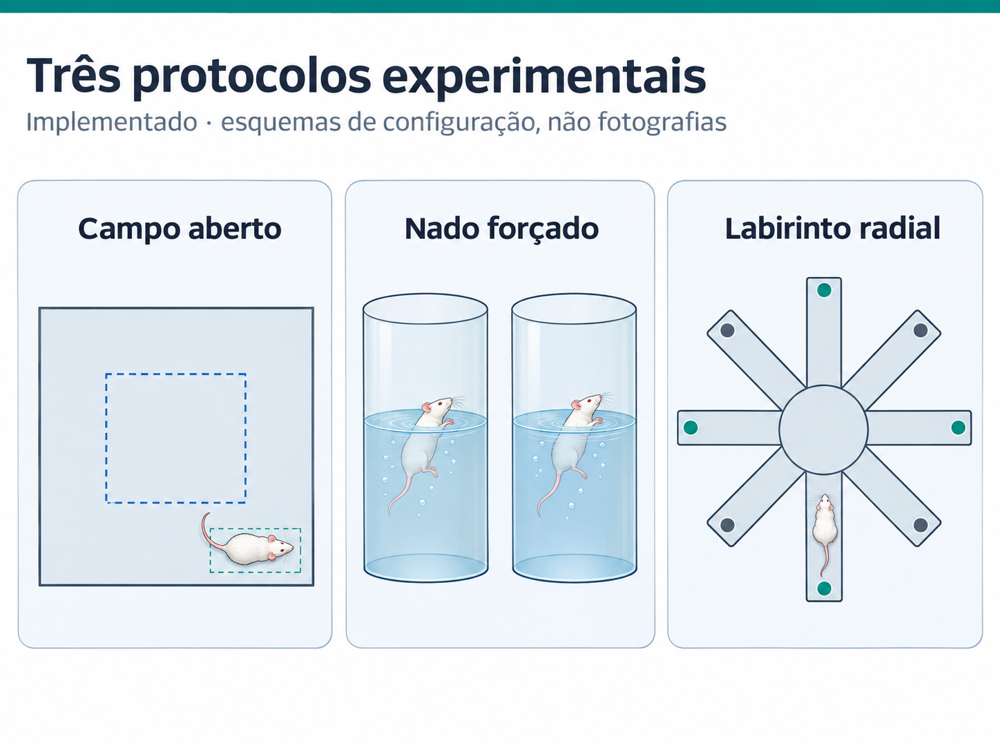
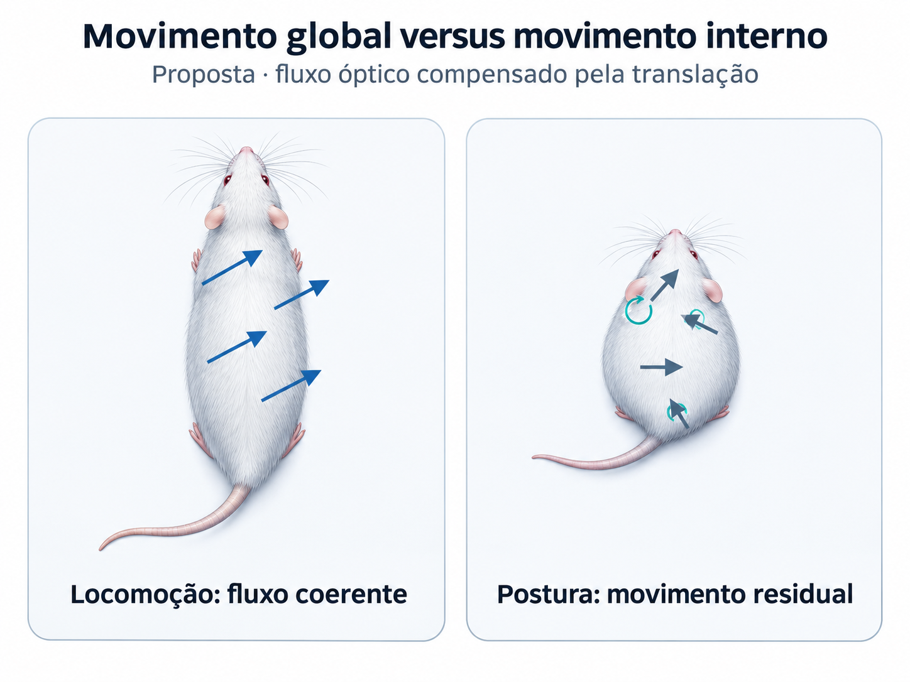
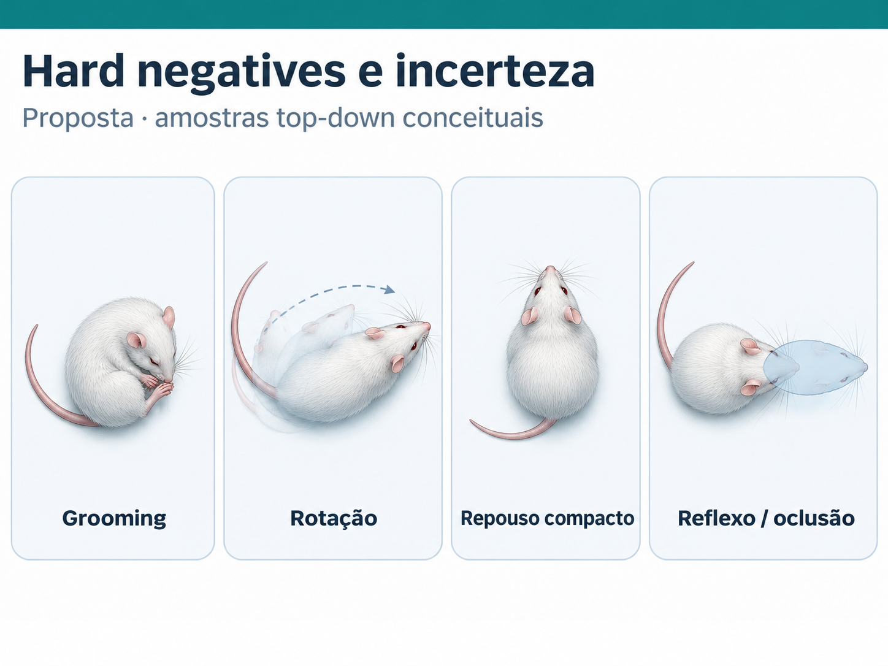

<p align="center">
  
</p>

<h1 align="center">Behavior Tracker</h1>
<p align="center"><strong>Computational neuroethology · Markerless tracking · Quantitative behavioral analysis</strong></p>
<p align="center">Plataforma de análise de experimentos comportamentais em roedores, com processamento local em CPU e inferência neural opcional no Google Colab.</p>
<p align="center">
  <a href="https://github.com/CodesOfGabriel/behaviortracker/releases">Downloads</a> ·
  <a href="#protocolos-experimentais">Protocolos</a> ·
  <a href="#fundamentação-matemática">Metodologia</a> ·
  <a href="#rearing-top-down--linha-de-desenvolvimento">Pesquisa em rearing</a> ·
  <a href="#referências">Referências</a>
</p>

> **Estado científico:** software de pesquisa em desenvolvimento. Os pipelines de tracking e os indicadores descritos abaixo estão implementados em diferentes níveis de maturidade. A classificação automática de rearing por CNN/TCN é uma linha de desenvolvimento proposta, não uma funcionalidade disponível ou validada. Não utilizar estimativas experimentais como substitutas de medidas revisadas sem validação no protocolo de interesse.

## Visão geral

A análise de ensaios comportamentais em neurociências frequentemente exige horas de inspeção de vídeo, anotação manual e revisão de eventos. A variabilidade interobservador, as diferenças de iluminação, reflexos, oclusões e configurações de câmera tornam a padronização de medidas um desafio metodológico.

O **Behavior Tracker** integra técnicas de visão computacional, processamento de sinais e estimativa de pose sem marcadores (*markerless pose estimation*) em uma aplicação desktop destinada a pesquisadores. A proposta é reduzir barreiras computacionais e operacionais, preservando o acesso aos dados brutos, o controle de qualidade e a possibilidade de revisão humana.

A aplicação separa três problemas: **localização do animal**, **representação da postura** e **interpretação do comportamento**. Um resultado de tracking, mesmo visualmente plausível, não é automaticamente uma classificação comportamental ou uma medida anatômica válida.

Desenvolvido por **Gabriel Santos** e **Thiago Vargas**, em parceria entre o **Laboratório Neurocell** e o **NeuroLab da Universidade Federal de Pelotas (UFPel)**.

## Protocolos experimentais


*Figura 1. Configuração conceitual dos protocolos. Os desenhos não representam dimensões obrigatórias de aparatos.*

| Protocolo | Processamento local | Processamento neural | Indicadores e limites atuais |
|---|---|---|---|
| **Open Field Test (OFT)** | OpenCV: silhueta, caixas, trajetória; Wistar + HRNet como alternativa | Detector Wistar + HRNet-W32, 27 pontos, local ou Colab | Distância, velocidade, centro/periferia, entradas, imobilidade operacional e cobertura, conforme elegibilidade. Rearing automático ainda não validado. |
| **Forced Swim Test (FST)** | Presença e características de movimento por cilindro | SuperAnimal Quadruped, HRNet-W32, 39 pontos, Colab | Presença, movimento relativo, alteração de silhueta e cobertura anatômica. Imobilidade, natação e escalada permanecem `NOT_CLASSIFIED` até anotação humana. |
| **Radial Arm Maze (RAM)** | Tracking clássico ou RAM Color experimental | Wistar + HRNet experimental no Colab | Localização, trajetória, revisão e geometria dos potes. Escolhas, erros de memória e consumo não são inferências automáticas validadas. |

### Campo aberto

O OFT investiga dimensões da atividade locomotora e do padrão de exploração espacial. O pesquisador define os quatro cantos do piso, a borda superior, as dimensões em centímetros e a fração central da arena. A borda delimita o contexto visual; a homografia do piso é utilizada para a conversão espacial. A postura ereta e as projeções na parede podem violar a hipótese de movimento no plano calibrado.

O tempo no centro, a exploração periférica e a atividade locomotora são indicadores dependentes de espécie, linhagem, idade, condições ambientais e desenho experimental. Isoladamente não constituem diagnóstico de ansiedade ou de outro estado afetivo.

### Nado forçado

A análise acompanha um ou dois sujeitos, cada qual associado a uma ROI fixa do cilindro. A presença visual é determinada independentemente da disponibilidade dos pontos anatômicos. O modo neural utiliza caixas corporais por frame para contextualizar a estimativa HRNet. O sistema preserva intervalos incertos em vez de interpretá-los como ausência, imobilidade ou outro comportamento.

Consultar o [contrato FST](docs/FST_CONTRACT.md). A análise de atividade não permite, isoladamente, inferir um estado depressivo.

### Labirinto radial

A preparação permite delimitar a área transitável, oito potes e quatro recompensas. O motor de eventos existente para geometrias com braços e linhas definidos distingue visitas iniciais e revisitas. Entretanto, um contorno único não é suficiente para estabelecer esses eventos. A trajetória atual não constitui prova de escolha ou consumo; proximidade ao pote não confirma ingestão.

Consultar o [contrato RAM](docs/RAM_CONTRACT.md).

## Instalação e fluxo de trabalho

1. Baixe o instalador correspondente ao sistema em [GitHub Releases](https://github.com/CodesOfGabriel/behaviortracker/releases), quando disponível. Os bundles de pesos não são instaladores. Windows x64, macOS Intel/Apple Silicon e Linux x64 possuem formatos de distribuição próprios.
2. Crie um experimento, identifique sujeito(s), protocolo e vídeo original.
3. Defina a geometria correspondente: piso e borda no OFT, cilindro(s) no FST ou área transitável e potes no RAM.
4. Escolha a análise local ou, quando aplicável, conecte a conta Google e selecione o Colab. A execução local não exige autenticação Google; a remota exige autorização e runtime compatível com CUDA.
5. Confira os resultados, a cobertura, o vídeo de auditoria e os intervalos com evidência insuficiente. Selecione a execução que pretende interpretar.
6. Exporte os dados brutos, revisões, métricas e manifestos. Preserve também o vídeo original.

O modo **OpenCV rápido · CPU** não depende de download de pesos neurais. O modo Wistar local instala um ambiente Python isolado sob demanda. FFmpeg e FFprobe são distribuídos com os instaladores. O fluxo de preparação remota pode criar cópia H.264 sem áudio, limitada a 1080p para vídeos grandes, verificando o alinhamento de frames e tempos antes do envio. Se a otimização não for adequada, o original é utilizado. O aplicativo não sincroniza experimentos entre computadores.

## Arquitetura computacional

### 1. Tracking clássico local

A estratégia `classical_roi_v1` (`opencv-box-9` na revisão documentada) realiza segmentação sem rede neural. O FFmpeg decodifica o vídeo, normalmente em largura de 640 px (480 e 960 px também disponíveis), e o FFprobe fornece os timestamps de apresentação (PTS). Até 31 amostras distribuídas pela sessão formam uma referência de fundo por mediana temporal. Essa referência permanece fixa, reduzindo a incorporação posterior de animais imóveis ao fundo.

O motor limita o processamento à ROI, combina luminância e cromaticidade Lab, limiares robustos, operações morfológicas e seleção de componentes candidatos. A associação utiliza posição, aparência, área, preenchimento, relação com o piso e continuidade. O filtro de Kalman estima posição em perdas curtas, enquanto fluxo óptico Lucas–Kanade bidirecional auxilia a associação visual. Predições e recuperações não equivalem a observações confirmadas.

As caixas e os contornos retornam às coordenadas originais. O descritor `silhouette-features-1` registra área, aspect ratio, extent, eixo principal, movimento do centroide da máscara e diferenças temporais. Os arquivos `samples.jsonl` e `motion_features.jsonl` preservam os resultados por frame. A qualidade do tracking e a adequação geométrica para medidas no piso são dimensões independentes.

### 2. Tracking neural e estimativa de pose

O detector Faster R-CNN com backbone ResNet-50 FPN v2 identifica o animal (classe animal e fundo) e fornece caixas com contexto espacial à HRNet-W32. A estimativa de pose utiliza DeepLabCut 3.0.2 e o bundle Wistar, com 27 pontos nomeados e likelihood por ponto. A versão v2 adiciona critérios de ROI, piso e continuidade à seleção de caixas. O pipeline compartilhado preserva poses brutas e exporta uma variante filtrada F+C (mediana temporal de cinco amostras, condicionada à confiança e disponibilidade). A pose canônica não deve ser confundida com a saída filtrada.

O modo local pode executar em CPU ou NVIDIA CUDA compatível; o remoto utiliza GPU CUDA do Colab, com comunicação MCP e monitoramento de workers. A correspondência de frames é verificada. O pipeline neural exporta tempo nominal por frame/FPS da entrada; o alinhamento com o relógio original deve ser verificado especialmente em vídeo VFR. O fluxo clássico local mantém os PTS originais.

### 3. Eixo geométrico e skeleton anatômico


*Figura 2. A linha de até sete pontos é uma aproximação da silhueta, não um mapa de articulações. Os pontos da pose neural são ilustrativos, não uma reprodução exata dos 27 pontos do modelo.*

O modo rápido calcula o eixo principal da máscara e centros de seções transversais. A renderização pode ponderar os centros pela distância ao fundo. Silhuetas aproximadamente circulares podem manter a direção visual anterior, quando há continuidade. Os extremos não identificam necessariamente cabeça e cauda. Uma caixa prevista sem contorno não recebe um skeleton inventado.

O gráfico do MP4 clássico representa velocidade do centro da caixa em pixels por segundo, numa janela de dez segundos; não representa automaticamente velocidade no piso em centímetros por segundo. A renderização é derivada dos dados armazenados e pode ser refeita sem novo tracking.

## Fundamentação matemática

### Notação e relógio

As fórmulas desta seção descrevem os indicadores atuais ou sua base matemática. As propostas para classificação de rearing continuam identificadas como pesquisa na seção seguinte.

| Símbolo | Significado |
|---|---|
| $`i`$ | Índice do frame na sequência do vídeo. |
| $`I_i`$ | Imagem do frame; $`I_i(x,y)`$ é a intensidade ou cor do pixel na posição $`(x,y)`$. |
| $`t_i`$ | Instante de apresentação do frame, em segundos, obtido dos PTS do vídeo. |
| $`\Delta t_i=t_{i+1}-t_i`$ | Tempo efetivamente decorrido entre dois frames; pode variar em vídeos VFR. |
| $`M_i(x,y)`$ | Máscara binária: 1 para um pixel atribuído ao corpo, 0 para fundo. |
| $`\Omega_i`$ | Conjunto dos pixels em que $`M_i(x,y)=1`$. |
| $`B_i`$ | Caixa delimitadora do animal, com posição, largura e altura em pixels. |
| $`q_i`$ | Indicador de elegibilidade da observação: 1 quando atende à política da medida; 0 quando deve ser excluída. |

**Como ler:** $`\sum`$ significa somar; $`\mathbf{1}[\cdot]`$ vale 1 quando a condição entre colchetes é verdadeira e 0 quando é falsa. Letras em negrito representam vetores. $`\lVert\mathbf{a}\rVert_2`$ é o comprimento euclidiano de um vetor; $`\mathbf{a}\cdot\mathbf{b}`$ é o produto escalar; $`(\cdot)^\top`$ é a transposta de um vetor ou matriz. Para um conjunto, $`\lvert\Omega\rvert`$ é a quantidade de elementos. Quando se trata de intervalos temporais, as barras representam duração, em segundos.

Uma medida sem dados válidos ou com denominador nulo fica **não mensurável**. Um zero medido e um valor ausente têm significados diferentes. O tempo desconhecido deve ser preservado ao interpretar resultados.

### Referência de fundo e segmentação

Para um conjunto de amostras distribuídas no vídeo, a referência de fundo conceitual é:

```math
I_{\mathrm{fundo}}(x,y)=\mathrm{mediana}_{k=1,\ldots,K}\left(I_{s_k}(x,y)\right),
\qquad K\leq31
```

Aqui, $`K`$ é a quantidade de frames amostrados, $`k`$ identifica uma amostra e $`s_k`$ é o índice do frame escolhido. Para cada pixel $`(x,y)`$, a mediana resume os valores observados nas amostras; em uma imagem colorida, a operação pode ser feita por canal. O resultado $`I_{\mathrm{fundo}}`$ tem a mesma unidade de intensidade das imagens. A mediana reduz a influência de objetos móveis, mas pode incorporar um animal que ocupe o mesmo local na maioria das amostras.

Uma máscara de diferença simplificada é:

```math
M_i(x,y)=
\mathbf{1}\left[\rho\left(I_i(x,y),I_{\mathrm{fundo}}(x,y)\right)>\tau(x,y)\right]
R_{\mathrm{visual}}(x,y)
```

| Elemento | Significado |
|---|---|
| $`\rho`$ | Medida de diferença de luminância/crominância entre o frame e o fundo. |
| $`\tau(x,y)`$ | Limiar de diferença; deve estar na mesma escala da medida produzida por $`\rho`$. |
| $`R_{\mathrm{visual}}`$ | Máscara da região visual permitida para localizar o corpo: 1 dentro, 0 fora. |
| $`M_i`$ | Resultado binário da comparação, limitado à região visual. |

**Interpretação:** um pixel é candidato a corpo quando difere suficientemente do fundo e pertence à região analisável. A região visual pode incluir a projeção do animal na parede; ela não deve ser confundida com o piso usado para calibrar centímetros. O motor real combina limiares robustos, morfologia e associação temporal; a expressão é uma simplificação.

Área projetada, centroide da máscara e preenchimento da caixa:

```math
A_i=\sum_{x,y}M_i(x,y),
\qquad
\mathbf{c}_i=\frac{1}{A_i}\sum_{x,y}M_i(x,y)
\begin{bmatrix}x\\y\end{bmatrix},
\qquad
E_i=\frac{A_i}{w_i h_i}
```

$`A_i`$ é a área em px², $`\mathbf{c}_i=(c_{x,i},c_{y,i})^\top`$ é o centroide em pixels, e $`w_i`$ e $`h_i`$ são a largura e a altura da caixa na mesma escala da máscara. $`E_i`$ é uma fração sem unidade: uma máscara de 600 px² dentro de uma caixa de 1.000 px² tem preenchimento 0,60. O centroide é a média das posições dos pixels do corpo, e pode diferir do centro da caixa. Se a área for zero, não há centroide mensurável.

Ao reconverter coordenadas à resolução original, comprimentos mudam pelo fator de escala e áreas pelo quadrado desse fator. Misturar área de uma escala com caixa de outra torna o preenchimento incorreto.

### Eixo principal da silhueta

A distribuição dos pixels ao redor do centroide é resumida pela matriz de covariância:

```math
\Sigma_i=\frac{1}{A_i}\sum_{\mathbf{p}\in\Omega_i}
(\mathbf{p}-\mathbf{c}_i)(\mathbf{p}-\mathbf{c}_i)^\top,
\qquad
\Sigma_i\mathbf{v}_1=\lambda_1\mathbf{v}_1,
\qquad \lambda_1\geq\lambda_2
```

$`\mathbf{p}=(x,y)^\top`$ é a posição de um pixel do corpo. $`\Sigma_i`$ é uma matriz 2 × 2, em px², que descreve o espalhamento horizontal, vertical e conjunto. $`\lambda_1`$ e $`\lambda_2`$ são seus autovalores, também em px²; o maior indica a direção de maior espalhamento. O autovetor unitário $`\mathbf{v}_1`$ aponta nessa direção.

**Interpretação:** uma silhueta comprida tem uma direção principal mais definida. Se os dois autovalores forem próximos, a máscara é quase circular e o eixo fica instável. O eixo não identifica cabeça ou cauda: $`\mathbf{v}_1`$ e $`-\mathbf{v}_1`$ descrevem a mesma linha.

Uma representação equivalente utiliza momentos centrais:

```math
\mu_{pq}=\sum_{(x,y)\in\Omega_i}(x-c_{x,i})^p(y-c_{y,i})^q,
\qquad
\theta_i=\frac{1}{2}\mathrm{atan2}(2\mu_{11},\mu_{20}-\mu_{02})
```

$`p`$ e $`q`$ são as ordens do momento, e não índices de frames. $`\mu_{20}`$ mede espalhamento horizontal, $`\mu_{02}`$ vertical e $`\mu_{11}`$ sua variação conjunta. A função $`\mathrm{atan2}(a,b)`$ considera os sinais de ambos os argumentos para calcular o ângulo. $`\theta_i`$ é a orientação do eixo na imagem, em radianos, com ambiguidade de 180°. Ela não é o ângulo de elevação física do corpo.

### Continuidade temporal: Kalman e fluxo óptico

O filtro de Kalman combina uma previsão de movimento com uma observação aceita pelo rastreador:

```math
\mathbf{x}=[x,y,v_x,v_y]^\top,
\qquad
\hat{\mathbf{x}}^-_i=F_i\hat{\mathbf{x}}_{i-1},
\qquad
P_i^-=F_iP_{i-1}F_i^\top+Q_i
```

```math
K_i=P_i^-H_o^\top(H_oP_i^-H_o^\top+R_i)^{-1},
\qquad
\hat{\mathbf{x}}_i=
\hat{\mathbf{x}}^-_i+K_i(\mathbf{z}_i-H_o\hat{\mathbf{x}}^-_i)
```

| Elemento | Significado |
|---|---|
| $`x,y,v_x,v_y`$ | Posição e velocidade horizontal/vertical na imagem; em uma parametrização por segundos, as unidades são px e px/s. |
| $`\hat{\mathbf{x}}_{i-1}`$ | Estado estimado no passo anterior; o chapéu indica uma estimativa. |
| $`F_i`$ | Matriz de evolução do movimento. No modelo de velocidade constante, avança a posição usando a velocidade e o intervalo de tempo. |
| $`\hat{\mathbf{x}}^-_i,P_i^-`$ | Estado previsto e sua matriz de incerteza, antes de incorporar a observação. O sinal sobrescrito “−” identifica a previsão. |
| $`P_{i-1},Q_i`$ | Incerteza anterior e covariância do ruído do modelo de movimento. |
| $`\mathbf{z}_i,H_o`$ | Posição observada e matriz que extrai do estado as grandezas comparáveis à observação. |
| $`R_i`$ | Covariância do erro da observação; maior incerteza reduz a influência dessa observação na correção. |
| $`K_i`$ | Ganho de Kalman: pondera quanto a previsão deve ser corrigida. |
| $`\mathbf{z}_i-H_o\hat{\mathbf{x}}^-_i`$ | Diferença entre a observação e o que o modelo previa observar, chamada inovação. |
| $`(\cdot)^{-1}`$ | Inversa da matriz; faz parte do cálculo do ganho. |

**Interpretação:** a previsão ajuda a manter continuidade em perdas curtas, mas uma posição prevista continua sendo estimada. Ela não confirma presença, identidade, cabeça, cauda ou rearing, nem se torna elegível para métricas apenas por parecer suave. As equações descrevem o modelo conceitual; associação e rejeição de observações também dependem dos critérios do rastreador.

A hipótese clássica de constância de brilho subjacente ao fluxo óptico é:

```math
I_x u+I_y v+I_t\approx0
```

$`I_x`$ e $`I_y`$ são as derivadas espaciais da intensidade, e $`I_t`$ é sua derivada temporal, não uma imagem indexada por tempo nesta equação. $`u`$ e $`v`$ são as componentes da velocidade aparente do pixel. Se o tempo está em segundos, suas unidades são px/s. Quando um algoritmo retorna deslocamento entre frames, é necessário dividir esse deslocamento pelo intervalo de tempo para obter velocidade.

A expressão aproxima a ideia de que um mesmo detalhe mantém seu brilho enquanto se desloca pouco. Iluminação variável, reflexos e oclusão violam essa hipótese. A verificação bidirecional compara o deslocamento de ida com o de volta; o fluxo isolado não confirma uma observação do animal.

### Calibração espacial e trajetória do OFT

A homografia converte posições da imagem para o plano do piso calibrado:

```math
\begin{bmatrix}u\\v\\w\end{bmatrix}
=H\begin{bmatrix}x\\y\\1\end{bmatrix},
\qquad
\mathbf{r}_i=\left(\frac{u}{w},\frac{v}{w}\right)
```

$`H`$ é a matriz 3 × 3 determinada pelos quatro cantos e dimensões reais da arena. $`x,y`$ são coordenadas em pixels; $`u,v,w`$ são coordenadas homogêneas intermediárias. Após dividir por $`w`$, $`\mathbf{r}_i`$ é a posição no piso, em centímetros. Um $`w`$ nulo ou numericamente muito próximo de zero impede a projeção. Os símbolos $`u,v`$ nesta transformação não representam o fluxo óptico da seção anterior.

**Limite físico:** a homografia vale para o plano calibrado. Projetar a cabeça elevada ou a silhueta sobre a parede não mede sua altura nem garante uma posição corporal correta no chão.

Para a trajetória, a referência pode ser um ponto revisado ou, em uma política de estimativa separada, o centro de caixas observadas elegíveis. O indicador $`g_i`$ vale 1 somente quando os frames são consecutivos, ambas as posições são elegíveis no piso e $`0<\Delta t_i\leq0{,}5\,\mathrm{s}`$; vale 0 nos demais casos. O limite é configurável pela política de métricas.

```math
D=\sum_{i:g_i=1}\lVert\mathbf{r}_{i+1}-\mathbf{r}_i\rVert_2,
\qquad
T_v=\sum_{i:g_i=1}\Delta t_i,
\qquad
\bar{v}=\frac{D}{T_v}
```

```math
v_i=\frac{\lVert\mathbf{r}_{i+1}-\mathbf{r}_i\rVert_2}{\Delta t_i}
\quad\text{para }g_i=1
```

| Elemento | Significado e unidade |
|---|---|
| $`D`$ | Soma das distâncias entre posições consecutivas válidas, em cm. |
| $`T_v`$ | Tempo coberto por esses pares válidos, em s. |
| $`\bar{v}`$ | Velocidade média no tempo válido, em cm/s. |
| $`v_i`$ | Velocidade média no intervalo entre dois frames, em cm/s; não é uma velocidade instantânea medida continuamente. |

Somar apenas sobre pares válidos evita tratar posições ausentes como coordenadas ou ligar os extremos de uma lacuna. Sem pares elegíveis, distância e velocidade ficam não mensuráveis. **Exemplo:** 120 cm percorridos em 10 s válidos correspondem a 12 cm/s, mesmo que o vídeo contenha outros 20 s sem observação utilizável.

Para um centro retangular proporcional, a fração central **de área** $`f`$ determina:

```math
W_C=W\sqrt{f},
\qquad
L_C=L_{\mathrm{arena}}\sqrt{f}
```

$`W`$ e $`L_{\mathrm{arena}}`$ são as dimensões físicas da arena, e $`W_C,L_C`$ as dimensões da região central, em cm. O centro fica alinhado ao centro da arena. Por exemplo, $`f=0{,}25`$ em uma arena de 50 × 50 cm produz uma região central de 25 × 25 cm: 25% da área, não 25% de cada lado.

O tempo em cada zona considera somente intervalos com dois extremos válidos:

```math
T_C=\sum_{i:g_i=1}\mathbf{1}[\mathbf{r}_i\in C]\Delta t_i,
\qquad
T_P=\sum_{i:g_i=1}\mathbf{1}[\mathbf{r}_i\notin C]\Delta t_i
```

```math
T_{\mathrm{desconhecido}}=T_{\mathrm{analise}}-(T_C+T_P),
\qquad
\%C=100\frac{T_C}{T_C+T_P},
\qquad
\mathrm{Cobertura}=100\frac{T_C+T_P}{T_{\mathrm{analise}}}
```

$`C`$ é a região central; $`T_C`$ e $`T_P`$ são os tempos em centro e periferia, em segundos. A zona da posição inicial do par é atribuída ao intervalo; isso não reconstrói o instante exato de um cruzamento entre frames. $`T_{\mathrm{analise}}`$ é a duração do trecho analisado, somando os intervalos positivos entre timestamps. $`T_{\mathrm{desconhecido}}`$ conserva o tempo que não pôde ser atribuído a uma zona.

$`\%C`$ usa apenas o tempo espacialmente classificável; cobertura compara esse tempo com o trecho inteiro. Se 30 s forem analisados, 10 s forem válidos e 4 s destes estiverem no centro, o resultado será 40% de tempo central e 33,3% de cobertura. Sem tempo classificável, a porcentagem central é não mensurável.

As entradas no centro exigem transição observada da periferia e permanência mínima configurada, de 0,2 s na política documentada. A imobilidade operacional reúne intervalos contínuos com velocidade menor ou igual ao limiar e duração mínima; os padrões atuais são 2 cm/s e 0,5 s. Esses critérios definem uma medida locomotora operacional e não confirmam, por si, freezing ou imobilidade etológica.

### Descritores de movimento

Para máscaras consecutivas na mesma escala e no mesmo sistema de coordenadas, a fração de pixels alterados é a diferença simétrica normalizada:

```math
J_{\Delta,i}=\frac{\lvert\Omega_i\mathbin{\triangle}\Omega_{i-1}\rvert}
{\lvert\Omega_i\cup\Omega_{i-1}\rvert}
```

$`\triangle`$ identifica pixels que pertencem a apenas uma das máscaras; $`\cup`$ é a união, que contém pixels de pelo menos uma delas. O numerador conta os pixels que mudaram e o denominador conta a área conjunta. $`J_{\Delta,i}`$ não tem unidade e varia de 0, para máscaras idênticas, a 1, para máscaras sem sobreposição. União vazia torna a medida não mensurável.

A diferença média de intensidade é:

```math
U_i=\Omega_i\cup\Omega_{i-1},
\qquad
\mathrm{MAD}_i=\frac{1}{\lvert U_i\rvert}
\sum_{p\in U_i}\lvert I_i(p)-I_{i-1}(p)\rvert
```

$`p`$ é uma posição de pixel da união $`U_i`$; a diferença absoluta compara sua intensidade nos dois frames. $`\mathrm{MAD}_i`$ é a **média das diferenças absolutas**, na escala de intensidade utilizada, e não a mediana dos desvios absolutos, que também recebe a sigla MAD em estatística. Em cinza de 8 bits, uma diferença é expressa na escala de 0 a 255.

Esses indicadores medem alteração visual. Iluminação, reflexos, erros de máscara e deslocamento global também podem aumentá-los. Eles não classificam rearing nem movimento vertical. Como essas diferenças não são divididas pelo tempo, comparações entre intervalos ou vídeos com frequências diferentes exigem considerar os timestamps.

## Controle de qualidade e evidência disponível

| Indicador DD2 (7.356 frames) | v8 | v9 |
|---|---:|---:|
| Localizações aceitas pelo tracking | 24,59% | 81,92% |
| Observações sem alertas | 3,11% | 8,90% |
| Velocidade do motor, sem renderização | 162,6 FPS | 80,5 FPS |

O aumento da aceitação não demonstra aumento da acurácia. Na execução v9, a política de estimativa no piso utilizou somente 23,54 s de aproximadamente 306,46 s (7,68%). A referência revisada permaneceu sem pares elegíveis. Os números não sustentam conclusões biológicas sobre a sessão inteira. O DD2 foi utilizado durante o desenvolvimento; não é um teste independente. Consultar os [relatórios de tracking](docs/reports/benchmark-dd2-reflections-2026-11-24.json) e de [métricas geométricas](docs/local-floor-box-metrics.md).

A política `oft-0.2` preserva a referência revisada. A alternativa `oft-floor-box-estimate-1` identifica explicitamente estimativas de centro de caixa no piso, sem promover `referenceApproved` ou alterar os dados originais.

---

## Rearing top-down — linha de desenvolvimento

> **Proposta de pesquisa (não implementada/validada):** classificador supervisionado visual-temporal, destinado a funcionar em CPU com uma única câmera superior. As figuras seguintes ilustram a metodologia planejada, não resultados de inferência ou telas existentes.

O rearing é uma forma de exploração vertical em que o animal eleva a região anterior do corpo, sustentado predominantemente pelos membros posteriores. Pode ocorrer com apoio externo (*supported rearing*) ou sem apoio (*unsupported rearing*). A definição deve ser operacionalizada no protocolo de anotação.


*Figura 3. A projeção bidimensional pode se tornar mais compacta durante rearing, mas esse sinal não é específico.*

Uma câmera superior não fornece diretamente a coordenada vertical $`Z`$. A diferença de posição entre cabeça e base da cauda no eixo $`y`$ da imagem não é altura física. O skeleton geométrico, por si só, não pode resolver a sobreposição anatômica ou confirmar contato das patas com uma parede. A hipótese de pesquisa é que a combinação de aparência, morfologia e dinâmica permite inferir o comportamento quando visualmente observável, mantendo uma classe de incerteza.

### Arquitetura proposta

O tracking fornece uma ROI dinâmica. A classificação utiliza crops RGB do vídeo original, descritores de forma e movimento, e contexto temporal. Um classificador separado preserva o rastreador existente e evita dependência obrigatória do DeepLabCut. A pose neural poderá ser avaliada como modalidade adicional, não como requisito.

### Descritores geométricos propostos


*Figura 4. Medidas projetadas do contorno e do eixo sem identidade anatômica.*

**Forma da silhueta.** As medidas abaixo resumem a projeção do corpo na imagem:

```math
\mathrm{Circularidade}=\frac{4\pi A}{P^2},
\qquad
\mathrm{Excentricidade}=\sqrt{1-\frac{b^2}{a^2}}
```

```math
\mathrm{Solidez}=\frac{A}{A_h},
\qquad
\mathrm{RazaoDeAspecto}=\frac{a}{b}
```

| Elemento | Significado |
|---|---|
| $`A,P`$ | Área e perímetro do contorno: px² e px, respectivamente, na mesma escala. |
| $`\pi`$ | Constante pi, aproximadamente 3,14159. |
| $`a\geq b>0`$ | Dimensões maior e menor de uma representação orientada do corpo. Podem ser semieixos de uma elipse; o extrator atual usa os lados do retângulo de área mínima, o que deve ser declarado ao comparar resultados. |
| $`A_h`$ | Área da envoltória convexa: o menor contorno convexo que envolve a silhueta. |

Todas as razões são adimensionais. Para uma forma circular ideal, circularidade = 1 e excentricidade = 0. Formas alongadas têm razão de aspecto maior e excentricidade mais próxima de 1. A solidez se aproxima de 1 em uma forma convexa e diminui quando há reentrâncias. A discretização do contorno afeta essas medidas; o extrator atual limita a circularidade a 1.

**Comprimento e tortuosidade do eixo.** Considere pontos ordenados da linha central:

```math
L_{\mathrm{eixo}}=\sum_{j=1}^{N-1}\lVert\mathbf{p}_{j+1}-\mathbf{p}_j\rVert_2,
\qquad
D_{\mathrm{extremos}}=\lVert\mathbf{p}_N-\mathbf{p}_1\rVert_2
```

```math
\mathrm{Tortuosidade}=\frac{L_{\mathrm{eixo}}}{D_{\mathrm{extremos}}}
\quad\text{se }D_{\mathrm{extremos}}>\varepsilon_L
```

$`\mathbf{p}_j`$ é o ponto de índice $`j`$ da linha central; $`N`$ é a quantidade de pontos. $`L_{\mathrm{eixo}}`$ soma os comprimentos dos segmentos em px, enquanto $`D_{\mathrm{extremos}}`$ mede a distância direta entre o primeiro e o último ponto, também em px. A tolerância $`\varepsilon_L`$ é um comprimento positivo pequeno, em px, escolhido para rejeitar extremos coincidentes ou numericamente indistinguíveis.

A tortuosidade é uma razão sem unidade: vale 1 para uma linha reta e aumenta com as curvas. Se o eixo mede 50 px e seus extremos estão separados por 40 px, a tortuosidade é 1,25. O comprimento é o da projeção geométrica; não é o comprimento anatômico tridimensional da coluna. Dados degenerados exigem máscara de validade, mesmo quando o código usa uma tolerância numérica para evitar divisão por zero.

**Mudança relativa de comprimento e área.** Para comparar frames na mesma escala:

```math
\Delta L_i=\frac{L_i-L_{i-k}}{L_{\mathrm{ref}}},
\qquad
\Delta A_i=\frac{A_i-A_{i-k}}{A_{\mathrm{ref}}}
```

$`L_i`$ e $`A_i`$ são comprimento do eixo e área no frame atual; $`i-k`$ identifica o frame anterior escolhido, separado por $`k`$ índices. $`L_{\mathrm{ref}}>0`$ e $`A_{\mathrm{ref}}>0`$ são referências de comprimento e área obtidas pela política de calibração definida para a sessão. Cada referência tem a mesma unidade de seu numerador. Sem referência positiva ou observações válidas, a variação fica ausente. O intervalo físico da comparação é a diferença entre os PTS, não necessariamente $`k/\mathrm{FPS}`$.

As duas variações são adimensionais: −0,20 indica uma redução correspondente a 20% da referência, não necessariamente 20% do valor do frame anterior. Encurtamento projetado pode ser uma evidência de postura, mas também resulta de rotação, oclusão ou erro de segmentação. Isoladamente não confirma rearing.

**Curvatura local, passo a passo.** Para três pontos consecutivos e $`2\leq j\leq N-1`$, primeiro formam-se os segmentos:

```math
\mathbf{d}_{j-1}=\mathbf{p}_j-\mathbf{p}_{j-1},
\qquad
\mathbf{d}_j=\mathbf{p}_{j+1}-\mathbf{p}_j
```

O produto escalar normalizado fornece o cosseno do ângulo entre eles:

```math
c_j=\frac{\mathbf{d}_{j-1}\cdot\mathbf{d}_j}
{\lVert\mathbf{d}_{j-1}\rVert_2\lVert\mathbf{d}_j\rVert_2},
\qquad
\widetilde{c}_j=\min(1,\max(-1,c_j))
```

Finalmente, calcula-se o ângulo e divide-se pelo comprimento local médio:

```math
\alpha_j=\arccos(\widetilde{c}_j),
\qquad
\ell_j=\frac{\lVert\mathbf{d}_{j-1}\rVert_2+\lVert\mathbf{d}_j\rVert_2}{2},
\qquad
\kappa_j=\frac{\alpha_j}{\ell_j}
```

| Elemento | Significado e unidade |
|---|---|
| $`\mathbf{d}_{j-1},\mathbf{d}_j`$ | Vetores de dois segmentos consecutivos, em px. Ambos precisam ter comprimento maior que a tolerância de validade. |
| $`c_j`$ | Cosseno calculado pelo produto escalar; não tem unidade. |
| $`\widetilde{c}_j`$ | Cosseno limitado ao intervalo de −1 a 1, evitando erros de arredondamento fora do domínio do arco cosseno. |
| $`\min,\max`$ | Operações que selecionam, respectivamente, o menor e o maior dos argumentos. |
| $`\arccos,\alpha_j`$ | Função arco cosseno e ângulo não negativo entre os segmentos, em radianos. |
| $`\ell_j`$ | Comprimento médio dos dois segmentos, em px. |
| $`\kappa_j`$ | Curvatura local normalizada pelo comprimento, em rad/px, usualmente escrita px⁻¹. |

Segmentos alinhados têm ângulo zero. Se formarem 90° e cada um medir 10 px, o ângulo será aproximadamente 1,571 rad e a curvatura 0,157 px⁻¹. Segmentos de comprimento zero tornam a medida não mensurável; não devem ser corrigidos artificialmente com uma curvatura zero.

Esta curvatura local é uma definição auxiliar. O campo atual `body_axis_curvature` de [silhouette_features.py](src-tauri/python/behavior/silhouette_features.py) soma os ângulos absolutos de mudança de direção, em radianos, sem dividir pelo comprimento; os dois valores não são intercambiáveis. Perfis de largura devem conservar uma convenção invariável à inversão do eixo, para que uma troca de extremos não produza uma falsa mudança de forma.

### Movimento interno


*Figura 5. O deslocamento do centroide não é suficiente para identificar atividade postural.*

Considere agora $`\mathbf{u}_i(p)`$ como o **deslocamento** de um ponto visual entre dois frames, em pixels, e não uma velocidade já dividida pelo tempo. A translação residual mediana pode ser removida:

```math
\mathbf{u}_{\mathrm{med},i}=
\mathrm{mediana}_{p\in S_i}\left(\mathbf{u}_i(p)\right),
\qquad
\mathbf{u}'_i(p)=\mathbf{u}_i(p)-\mathbf{u}_{\mathrm{med},i}
```

```math
V_{\mathrm{interno},i}=
\frac{1}{\lvert S_i\rvert\Delta t_i}
\sum_{p\in S_i}\lVert\mathbf{u}'_i(p)\rVert_2
```

$`S_i`$ é o conjunto de pontos corporais com correspondências válidas; no fluxo esparso, a soma usa apenas os pontos rastreados. $`\mathbf{u}_{\mathrm{med},i}`$ é a mediana de cada componente do deslocamento, que aproxima uma translação compartilhada. $`\mathbf{u}'_i(p)`$ é o deslocamento que sobra após subtrair essa translação. A norma mede seu tamanho sem depender da direção, e $`\lvert S_i\rvert`$ é a quantidade de correspondências válidas.

$`V_{\mathrm{interno},i}`$ é a média do deslocamento residual dividida por $`\Delta t_i`$, em px/s. Recortes redimensionados precisam ser reconvertidos à escala de referência antes dessa interpretação; o extrator atual faz essa correção. Sem correspondências válidas ou com intervalo de tempo inválido, a medida fica ausente.

**Interpretação:** se todos os pontos se deslocam juntos, o resíduo tende a ser pequeno. Se partes do corpo mudam de posição umas em relação às outras, pode aumentar. Rotação, reflexos e erros de correspondência também o aumentam; ele não mede diretamente movimento vertical. Fluxo esparso Lucas–Kanade e fluxo denso Farnebäck devem ser comparados em recortes reduzidos, sem exigir processamento denso do vídeo inteiro.

### Recorte dinâmico e escala espacial


*Figura 6. O centro do crop acompanha a caixa, mas a escala de referência deve permanecer estável.*

A bbox determina a região a observar; o crop é quadrado, com margem e escala de referência por sessão. Redimensionar cada bbox para preencher todo o input pode apagar informações de variação aparente de tamanho. Configuração inicial: 128 × 128 RGB, margem de aproximadamente 30%, fator de escala de referência 1,6 e frequência de inferência de 15 Hz. Esses valores são hiperparâmetros a comparar na validação.

A segunda passagem decodifica sequencialmente o original e utiliza caixas e PTS do tracking concluído. A geometria do piso não deve vetar observações comportamentais válidas perto das paredes. Ambiguidade, reflexos, identidade incerta e caixas apenas previstas exigem QC separado.

### Encoder visual e classificador temporal

Nesta proposta, $`n`$ identifica uma amostra da rede, por exemplo em uma sequência de 15 amostras por segundo. Ele é um índice, não um tempo em segundos. Cada amostra conserva o timestamp real do vídeo de origem.

```math
\mathbf{e}_n=f_\theta\left(\mathrm{recorte}(I_n,B_n)\right)\in\mathbb{R}^{128},
\qquad
\mathbf{z}_n=[\mathbf{e}_n;\mathbf{s}_n;\mathbf{m}_n;\mathbf{q}_n]
```

| Elemento | Significado |
|---|---|
| $`I_n,B_n`$ | Imagem e caixa associadas à amostra, com recorte feito no vídeo original. |
| $`\mathrm{recorte}`$ | Operação que seleciona a região da caixa com a margem e a escala de referência definidas. |
| $`f_\theta`$ | Encoder visual, uma rede que transforma o recorte em características; $`\theta`$ reúne seus parâmetros aprendidos. |
| $`\mathbf{e}_n\in\mathbb{R}^{128}`$ | Vetor de 128 números reais, chamado embedding. A dimensão é uma escolha inicial de arquitetura, não uma medida anatômica. |
| $`\mathbf{s}_n,\mathbf{m}_n`$ | Vetores de descritores de forma e movimento. |
| $`\mathbf{q}_n`$ | Máscaras que informam quais características estão disponíveis e válidas. |
| $`[\,;\,]`$ | Concatenação: os vetores são colocados em sequência para formar a entrada multimodal $`\mathbf{z}_n`$. |

O encoder aprende padrões visuais em conjunto com os rótulos humanos. Seus 128 componentes não equivalem a 128 pontos corporais. Cada embedding deve ser calculado uma vez e reutilizado nas janelas temporais. A normalização usa estatísticas do treinamento ou uma calibração por sessão previamente definida; o conjunto de teste não deve orientar essas escolhas.

Uma convolução temporal dilatada combina características de instantes próximos:

```math
\mathbf{h}_n^{(l)}=
\phi\left(
\sum_{j=-(k-1)/2}^{(k-1)/2}
W_j^{(l)}\mathbf{h}_{n+j d_l}^{(l-1)}
+\mathbf{b}^{(l)}
\right)
```

| Elemento | Significado |
|---|---|
| $`\mathbf{h}_n^{(l)}`$ | Características produzidas pela camada temporal de índice $`l`$ na amostra $`n`$; a entrada inicial pode ser $`\mathbf{h}_n^{(0)}=\mathbf{z}_n`$. |
| $`k`$ | Quantidade ímpar de posições do kernel, por exemplo 3. |
| $`j`$ | Deslocamento em relação à amostra central: para $`k=3`$, assume −1, 0 e 1. |
| $`d_l`$ | Dilatação da camada: distância, em amostras, entre as posições consultadas. |
| $`W_j^{(l)},\mathbf{b}^{(l)}`$ | Pesos e viés aprendidos na camada. |
| $`\phi`$ | Função de ativação não linear, como ReLU; sua escolha faz parte da arquitetura. |

Com uma convolução por camada, stride 1, kernel de tamanho 3 e dilatações 1, 2, 4 e 8, o campo receptivo é:

```math
R_{\mathrm{rede}}=1+(k-1)\sum_l d_l
=1+2(1+2+4+8)=31
```

$`R_{\mathrm{rede}}`$ é a quantidade de amostras de entrada que podem influenciar uma saída; a soma percorre as camadas. A 15 Hz, a distância temporal entre a primeira e a última das 31 amostras é $`(31-1)/15=2\,\mathrm{s}`$. O resultado depende da arquitetura: adicionar convoluções, mudar stride ou kernel altera esse campo. Como o processamento é offline, a janela pode incluir passado e futuro, preservando limites de sessão e máscaras de validade.

A cabeça principal produz um score de rearing a partir dessa janela:

```math
p_n=\sigma\left(g_\psi(\mathbf{z}_{n-15:n+15})\right),
\qquad
\sigma(a)=\frac{1}{1+\exp(-a)}
```

$`g_\psi`$ é o classificador temporal, com parâmetros aprendidos $`\psi`$; $`\mathbf{z}_{n-15:n+15}`$ representa as 31 entradas da janela, incluindo os extremos. Sua saída numérica $`a`$, chamada logit, é transformada pela função sigmoide $`\sigma`$. A exponencial $`\exp`$ usa a base natural. O score $`p_n`$ fica entre 0 e 1, mas esse intervalo, sozinho, não comprova calibração probabilística nem acurácia.

A cabeça auxiliar estima o tipo de apoio, condicionado à ocorrência de rearing:

```math
\pi_{n,c}=
\frac{\exp(\ell_{n,c})}
{\sum_{r\in S}\exp(\ell_{n,r})},
\qquad c\in S
```

$`S`$ é o conjunto de subtipos que a cabeça distingue, por exemplo com apoio e sem apoio. $`\ell_{n,c}`$ é o logit do subtipo $`c`$; $`r`$ percorre todos os subtipos no denominador. A operação é o softmax, e os valores $`\pi_{n,c}`$ somam 1 dentro de $`S`$. Apoio não observável exige abstenção ou subtipo indeterminado conforme o contrato; não deve ser forçado para uma das duas classes.

**Como os rótulos orientam o treinamento.** Uma perda binária ponderada e uma perda de subtipo podem ser combinadas:

```math
\mathcal{L}_{R}=
-\frac{
\sum_n a_n\left[w_1 y_n\log(p_n)+w_0(1-y_n)\log(1-p_n)\right]
}{\sum_n a_n}
```

```math
\mathcal{L}_{S}=
-\frac{\sum_n b_n\log(\pi_{n,c_n})}{\sum_n b_n},
\qquad
\mathcal{L}=\mathcal{L}_{R}+\lambda\mathcal{L}_{S}
```

| Elemento | Significado |
|---|---|
| $`y_n`$ | Rótulo humano binário: 1 para rearing e 0 para não rearing observável. |
| $`a_n`$ | Máscara de treinamento: 1 quando existe rótulo binário utilizável; 0 para trechos desconhecidos, não revisados ou excluídos. |
| $`w_1,w_0`$ | Pesos das classes positiva e negativa, definidos para lidar com desequilíbrio no treinamento. |
| $`\log`$ | Logaritmo natural; o cálculo computacional deve ser numericamente estável. |
| $`c_n`$ | Subtipo humano de referência da amostra. |
| $`b_n`$ | Máscara que vale 1 somente para rearing com subtipo observável e anotado. |
| $`\mathcal{L}_R,\mathcal{L}_S`$ | Erros de treinamento para ocorrência de rearing e subtipo de apoio, respectivamente. |
| $`\lambda`$ | Peso não negativo que regula a contribuição do subtipo no erro total $`\mathcal{L}`$. |

As perdas são adimensionais: aumentam quando a rede atribui score baixo ao rótulo correto. O treinamento procura reduzi-las, mas uma perda pequena no treino não demonstra generalização. Se a soma de uma máscara for zero, esse componente não tem exemplos válidos e não deve ser dividido por zero. Trechos ambíguos continuam mascarados conforme o protocolo de anotação.

### Decodificação dos episódios

Em amostras classificáveis, uma regra de histerese utiliza limiares diferentes para iniciar e terminar o estado positivo:

```math
\hat{y}_n=
\begin{cases}
1,& p_n\geq\tau_{\mathrm{on}}\\[2pt]
0,& p_n<\tau_{\mathrm{off}}\\[2pt]
\hat{y}_{n-1},& \text{caso contrario}
\end{cases},
\qquad
0\leq\tau_{\mathrm{off}}<\tau_{\mathrm{on}}\leq1
```

$`\hat{y}_n`$ é o estado estimado: 1 para rearing e 0 para não rearing. $`p_n`$ é o score atual; $`\tau_{\mathrm{on}}`$ é o limiar de início e $`\tau_{\mathrm{off}}`$ o de término. Entre os dois limiares, mantém-se o estado anterior $`\hat{y}_{n-1}`$. Isso reduz alternâncias provocadas por pequenas oscilações do score.

Por exemplo, com início em 0,75 e término em 0,40, um score de 0,60 mantém um estado já positivo, mas não inicia um episódio a partir de um estado negativo. A regra é conceitual e precisa de estado inicial definido, duração mínima e confirmação temporal.

Uma amostra sem evidência válida permanece desconhecida e fica fora dessa regra; ela não deve herdar automaticamente a classificação anterior. Lacunas e retorno confirmado à postura quadrúpede precisam ser tratados explicitamente para não unir episódios distintos.

| Parâmetro de piloto | Valor inicial, não validado |
|---|---:|
| Limiar de início | 0,75 |
| Limiar de término | 0,40 |
| Duração mínima | 0,20 s |
| Confirmação de início/término | 0,13 s |
| Lacuna máxima a avaliar | 0,15 s |

A resolução temporal nominal da inferência a 15 Hz é 66,7 ms. O resultado deve mapear cada previsão aos PTS reais e registrar o suporte temporal. Não substituir os timestamps por frame/FPS em vídeos VFR.

### Classes e anotação humana


*Figura 7. Comportamentos negativos visualmente semelhantes e situações que podem exigir a classe desconhecida.*

| Classe proposta | Definição |
|---|---|
| `REARING_SUPPORTED` | Elevação com apoio das patas anteriores identificável na gravação |
| `REARING_UNSUPPORTED` | Elevação sem apoio externo identificável |
| `REARING_UNSPECIFIED` | Elevação observável, tipo de apoio indeterminado |
| `NON_REARING` | Postura sem rearing claramente observável |
| `UNKNOWN` | Evidência visual insuficiente |

Grooming, rotação, investigação da parede em quadrupedia, repouso e reflexos devem integrar os exemplos difíceis. A proximidade da parede é contexto, não prova de apoio. Nenhum sensor ou câmera lateral é necessário para a proposta, mas a observabilidade de alguns episódios será limitada e a referência humana top-down compartilha essa limitação.

O dataset deverá armazenar `video_id`, `animal_id`, `session_id`, `arena_id`, SHA-256 do vídeo, início e fim do intervalo, classe e anotador. Revisores independentes devem anotar vídeos completos ou indicar explicitamente quais trechos foram revisados. Intervalos não anotados não equivalem a negativos.

### Métricas comportamentais propostas

Para episódios observados, use intervalos $`[s_j,e_j)`$: o instante inicial pertence ao episódio e o instante final marca sua saída. Esse acordo evita contar duas vezes uma fronteira compartilhada.

```math
d_j=(e_j-s_j)-u_j,
\qquad
T_R=\sum_{j=1}^{N_R}d_j,
\qquad
\bar{d}_R=\frac{T_R}{N_R}
```

```math
f_R=60\frac{N_R}{T_{\mathrm{classificavel}}},
\qquad
\%R=100\frac{T_R}{T_{\mathrm{classificavel}}},
\qquad
\mathrm{Cobertura}_R=100\frac{T_{\mathrm{classificavel}}}{T_{\mathrm{analise}}}
```

| Elemento | Significado e unidade |
|---|---|
| $`j,N_R`$ | Índice de um episódio e quantidade de episódios de rearing observados; a contagem não tem unidade de tempo. |
| $`s_j,e_j`$ | Início e fim do episódio, em segundos, no mesmo relógio da análise. |
| $`u_j`$ | Tempo desconhecido dentro dos limites do episódio, em s; é zero em um episódio integralmente observável. |
| $`d_j`$ | Duração observável do episódio, em s. Com lacunas, pode ser menor que sua duração física total. |
| $`T_R,\bar{d}_R`$ | Tempo total observável em rearing e duração média por episódio, em s. |
| $`T_{\mathrm{classificavel}}`$ | Tempo em que a ocorrência ou ausência de rearing pode ser avaliada, em s; exclui trechos desconhecidos. |
| $`T_{\mathrm{analise}}`$ | Duração do trecho de análise, em s. |
| $`f_R`$ | Frequência em episódios por minuto de tempo classificável; o fator 60 converte segundos em minutos. |
| $`\%R,\mathrm{Cobertura}_R`$ | Porcentagem do tempo classificável em rearing e porcentagem da análise que pôde ser classificada. |

**Exemplo:** cinco episódios, com 12 s observáveis de rearing em 120 s classificáveis de uma análise de 150 s, resultam em duração média de 2,4 s, frequência de 2,5 episódios/min, 10% de tempo em rearing e 80% de cobertura. Frequência e porcentagem descrevem o tempo observado; com cobertura incompleta, não estimam automaticamente a sessão inteira.

Se $`N_R=0`$, a duração média por episódio é não mensurável. Se não houver tempo classificável, frequência e porcentagem também são não mensuráveis. Uma lacuna não autoriza ligar dois eventos; os limites e a política de fragmentação precisam estar definidos antes do cálculo. Métricas automáticas e revisadas permanecem distintas.

A latência é:

```math
L_R=s_1-t_{\mathrm{inicio}}
```

$`s_1`$ é o início do primeiro episódio observado e $`t_{\mathrm{inicio}}`$ o início do trecho analisado, ambos em segundos. O resultado só representa a latência exata se o trecho anterior tiver sido observado suficientemente para descartar um episódio mais cedo. Com lacunas iniciais, relatar o primeiro evento observado e a limitação, sem inventar uma latência exata.


*Figura 8. Mockup com dados fictícios. Não representa uma tela já implementada nem resultados experimentais.*

### Treinamento, exportação e avaliação

A pesquisa deve comparar, com os mesmos splits por animal e sessão:

| Variante | Modalidades | Objetivo |
|---|---|---|
| A | Silhueta + movimento + Random Forest | Baseline leve |
| B | MobileNetV3-Small | Efeito da aparência sem temporalidade |
| C | MobileNetV3 + TCN | Efeito do contexto temporal |
| D | MobileNetV3 + silhueta + movimento + TCN | Fusão multimodal |

Realizar treinamento no Colab com PyTorch, exportar encoder e TCN para ONNX e executar com CPUExecutionProvider. Testar quantização INT8 apenas após demonstrar equivalência e desempenho no conjunto independente. Os pesos deverão ser distribuídos sob demanda, com tamanho, versão e SHA-256. O hardware de referência deve incluir CPU sem GPU dedicada. As metas de tamanho e velocidade são de engenharia, não medições estabelecidas.

### Validação científica

A avaliação deve separar animais/sessões inteiras em treinamento, validação e teste. A escolha de limiares, hiperparâmetros e calibração ocorre sem acesso ao teste. Um piloto de 5–10 vídeos e 100–200 episódios pode orientar desenvolvimento; um conjunto ampliado e curvas de aprendizagem devem determinar a quantidade de dados necessária. Não são tamanhos amostrais garantidos.

**Acertos e erros de classificação.** Precisão e sensibilidade respondem a perguntas diferentes:

```math
\mathrm{Precisao}=\frac{TP}{TP+FP},
\qquad
\mathrm{Sensibilidade}=\frac{TP}{TP+FN},
\qquad
F_1=\frac{2TP}{2TP+FP+FN}
```

| Elemento | Significado |
|---|---|
| $`TP`$ | Verdadeiros positivos: frames ou episódios de rearing corretamente identificados. |
| $`FP`$ | Falsos positivos: frames ou episódios propostos como rearing sem correspondência na referência humana. |
| $`FN`$ | Falsos negativos: rearings da referência humana que o detector não identificou. |
| Precisão (*precision*) | Entre as detecções positivas, qual fração era correta? |
| Sensibilidade (*recall*) | Entre os rearings da referência humana, qual fração foi detectada? |
| $`F_1`$ | Média harmônica entre precisão e sensibilidade, expressa acima diretamente pelas contagens. |

As razões variam de 0 a 1 quando definidas; multiplique por 100 para apresentar porcentagens. Por exemplo, 8 acertos, 2 propostas falsas e 4 episódios perdidos dão precisão de 80%, sensibilidade de 66,7% e F1 de aproximadamente 72,7%. Contagens por frame e por episódio são avaliações separadas e não devem ser misturadas no mesmo denominador.

Denominadores nulos exigem uma convenção de avaliação declarada; ausência de dados avaliáveis não é desempenho perfeito. A referência precisa cobrir os trechos avaliados: intervalos não revisados não fornecem automaticamente verdadeiros negativos nem garantem a contagem de episódios perdidos.

**Sobreposição temporal dos episódios.** Para um intervalo previsto $`P`$ e um intervalo humano $`G`$:

```math
\mathrm{tIoU}(P,G)=\frac{\lvert P\cap G\rvert}{\lvert P\cup G\rvert}
```

$`\cap`$ indica a interseção, o tempo compartilhado pelos dois intervalos; $`\cup`$ indica a união, o tempo coberto por pelo menos um. As durações no numerador e denominador usam segundos, e a razão é adimensional. tIoU = 1 significa coincidência temporal completa; tIoU = 0 significa ausência de sobreposição.

Se a referência for de 10 a 12 s e a previsão de 11 a 13 s, a interseção mede 1 s e a união 3 s, produzindo tIoU = 1/3. Uma correspondência de episódios **um para um**, com limiar pré-especificado, por exemplo 0,5, permite calcular F1 por evento e impede que várias propostas contem como acertos do mesmo episódio.

**Magnitude do erro.** Para comparar contagens, durações ou instantes:

```math
\mathrm{MAE}=\frac{1}{n}\sum_{j=1}^{n}\lvert\hat{a}_j-a_j\rvert,
\qquad
\mathrm{RMSE}=\sqrt{\frac{1}{n}\sum_{j=1}^{n}(\hat{a}_j-a_j)^2}
```

$`n`$ é a quantidade de pares avaliados; $`a_j`$ é o valor de referência e $`\hat{a}_j`$ a estimativa correspondente. MAE é a média dos erros absolutos. RMSE eleva os erros ao quadrado antes de tirar a média e a raiz, dando maior influência a erros grandes. Ambos têm a unidade da grandeza comparada: segundos para início/fim e duração, ou episódios para contagem. Comparações de início/fim exigem pareamento entre eventos; eventos perdidos e extras continuam contabilizados separadamente.

**Erro espacial de pontos corporais.** Uma forma de apresentar PCK (*Percentage of Correct Keypoints*) é:

```math
\mathrm{PCK}(r)=\frac{100}{n}
\sum_{j=1}^{n}
\mathbf{1}\left[\lVert\hat{\mathbf{p}}_j-\mathbf{p}_j\rVert_2\leq r\right]
```

$`\mathbf{p}_j`$ é o ponto anatômico humano, $`\hat{\mathbf{p}}_j`$ o ponto previsto, e $`r`$ a tolerância espacial declarada. $`n`$ conta pares válidos do mesmo ponto e frame. Coordenadas e tolerância precisam usar a mesma escala e unidade, como pixels na resolução original. Se o limiar for normalizado pelo tamanho do corpo, essa regra também precisa ser informada. O resultado é a porcentagem de pontos dentro da tolerância; pontos sem referência humana utilizável não viram acertos por estimativa.

**Concordância entre dois anotadores.** O kappa de Cohen compara a concordância observada com a esperada pelas frequências de uso das classes:

```math
p_o=\frac{1}{n}\sum_{j=1}^{n}\mathbf{1}[a_j=b_j],
\qquad
p_e=\sum_{c\in C}p_A(c)p_B(c),
\qquad
\kappa_C=\frac{p_o-p_e}{1-p_e}
```

| Elemento | Significado |
|---|---|
| $`a_j,b_j`$ | Classes atribuídas ao mesmo item pelos anotadores A e B; nesta equação, são rótulos, não as medidas numéricas da fórmula de MAE. |
| $`n`$ | Quantidade de itens pareados avaliados. |
| $`C,c`$ | Conjunto das classes e uma classe desse conjunto. |
| $`p_A(c),p_B(c)`$ | Frações de itens atribuídas à classe $`c`$ por cada anotador. |
| $`p_o`$ | Fração de acordos observados entre os anotadores. |
| $`p_e`$ | Concordância esperada a partir das frequências marginais de uso das classes. |
| $`\kappa_C`$ | Concordância corrigida por essa expectativa; não é a curvatura geométrica $`\kappa_j`$. |

Kappa = 1 indica concordância completa; 0 indica concordância igual à expectativa calculada, e valores negativos indicam concordância inferior a ela. Se $`p_e=1`$, o denominador é zero e o coeficiente não é mensurável. Por exemplo, $`p_o=0{,}90`$ e $`p_e=0{,}50`$ produzem kappa = 0,80. Frequência das classes e política para `UNKNOWN` influenciam a interpretação; declare a política e apresente também a concordância por classe.

Relatar cobertura, falsos positivos em hard negatives, falsos negativos, fragmentação, variabilidade por animal e condições de câmera. Reportar intervalos de confiança por unidade experimental, evitando pseudorreplicação de frames. Metas iniciais de desenvolvimento (não obtidas): F1 por frame e evento ≥ 0,90, cobertura ≥ 95%, erro mediano de início/fim ≤ 0,15 s. A incerteza não deve ser eliminada artificialmente para atingir as metas.

### Proveniência e roadmap

- [ ] Separar elegibilidade comportamental e geométrica, ampliar features sem alterar as métricas existentes.
- [ ] Consolidar ferramenta de anotação temporal e protocolo top-down.
- [ ] Construir dataset com splits independentes e baseline Random Forest.
- [ ] Treinar modelos visual-temporais e executar estudo de ablação.
- [ ] Exportar ONNX, testar FP32/INT8 e integrar distribuição versionada.
- [ ] Implementar jobs locais, decoder, métricas, ethogram e revisão humana.
- [ ] Validar em sessões independentes e documentar limites de generalização.

## Reprodutibilidade e exportação

Os resultados devem permanecer associados ao vídeo, à geometria, ao relógio, à execução e aos pesos utilizados. Os pipelines existentes registram hashes SHA-256, identificação de bundle, parâmetros e versões de runtime. O aplicativo preserva observações brutas e correções separadamente.

O [inventário de reprodutibilidade](docs/REPRODUCIBILITY.md) reúne dependências, ambientes, identificadores e hashes dos modelos, além das lacunas para reproduzir inferência e treinamento. Os checkpoints neurais são distribuídos separadamente e não integram o arquivo de código-fonte enviado pelo GitHub ao Zenodo.

| Artefato | Conteúdo |
|---|---|
| `samples.jsonl`, `motion_features.jsonl` | Observações clássicas e descritores locais |
| `background-reference.png`, `reference.json` | Referência visual e configuração do fundo |
| `detections.csv` | Detecções neurais por frame |
| `pose_raw.csv`, `pose_raw.h5` | Coordenadas e likelihood brutos |
| `pose_filtered.csv`, `qc_by_frame.csv` | Pose filtrada e controle de qualidade |
| `canonical_pose.csv` | Contrato canônico de pose |
| `run_manifest.json` | Proveniência da execução |
| `experiment.json`, `poses_raw.csv`, `poses_reviewed.csv`, `corrections.jsonl` | Exportações OFT e histórico de revisão |
| `metrics.csv`, `box_metrics_estimated.json` | Métricas revisadas e estimativas explicitamente separadas |
| MP4 de auditoria | Visualização derivada, não fonte primária de métricas |

Os arquivos disponíveis dependem do protocolo e modo de execução. Futuros artefatos de rearing (`frame_predictions.jsonl`, `behavior_events.csv`, `behavior_metrics.json`) pertencem ao roadmap, não ao contrato atual.

## Tecnologias e documentação

| Camada | Tecnologia atual |
|---|---|
| Interface | React, TypeScript, Vite |
| Desktop e orquestração | Tauri, Rust |
| Persistência | SQLite e arquivos de execução |
| Vídeo | FFmpeg, FFprobe |
| Visão computacional | OpenCV, NumPy |
| Inferência neural | PyTorch, TorchVision, DeepLabCut, HRNet |
| Execução remota | Google Colab via MCP |

Documentação técnica: [processamento local](docs/local-classical-processing.md), [overlays](docs/local-video-overlays.md), [métricas no piso](docs/local-floor-box-metrics.md), [distribuição de modelos](docs/MODEL_DELIVERY_V2.md), [estado da implementação](docs/IMPLEMENTATION_STATUS.md) e [guia de validação](docs/reports/VALIDATION_GUIDE_2026-11-18.md).

Para desenvolvedores, o site e o deploy são descritos em [deploy-web.yml](.github/workflows/deploy-web.yml) e [deploy-live.sh](scripts/deploy-live.sh); a distribuição desktop é independente do deploy web.

## Ética, limitações e uso responsável

O Behavior Tracker é uma ferramenta de apoio à análise de experimentos, não um substituto de protocolos aprovados, de treinamento de avaliadores ou de validação científica. Os estudos com animais devem seguir aprovação ética institucional e princípios aplicáveis de bem-estar e dos 3Rs (Replacement, Reduction, Refinement). A análise de vídeos de experimentos já realizados pode reduzir o retrabalho, mas não constitui autorização para experimentos adicionais.

Recomenda-se registrar condições de iluminação, posição de câmera, resolução, frame rate, dimensões do aparato, unidade experimental, protocolo de anotação e critérios de exclusão. A inferência local permanece no dispositivo; ao selecionar o Colab, o vídeo preparado e os dados necessários são transferidos ao runtime remoto do pesquisador. Revisar as políticas institucionais antes de utilizar processamento externo.

O desempenho varia conforme arena, câmera, linhagem, coloração, reflexos e oclusões. Os dados técnicos atuais não demonstram acurácia generalizável dos três protocolos. Nenhum modelo proposto de rearing foi treinado ou validado como parte deste README.

## Como citar

Os metadados estão em [CITATION.cff](CITATION.cff) e [.zenodo.json](.zenodo.json), com o título científico e a versão `0.1.7`. Ambos os autores estão afiliados ao Departamento de Fisiologia e Farmacologia, Instituto de Biologia, Universidade Federal de Pelotas (UFPel), conforme confirmação do responsável. O ORCID de Gabriel Silva Santos foi informado; de Thiago Alves Vargas, foi fornecido apenas o perfil ResearchGate. A edição científica do código-fonte é separada dos checkpoints neurais, datasets experimentais e instaladores. Consulte a [documentação do Zenodo](docs/ZENODO_PUBLICATION.md), a [revisão do conteúdo do arquivo](docs/releases/v0.1.7-source-review.md) e o [CHANGELOG](CHANGELOG.md).

O código próprio do projeto adota a [Apache License 2.0](LICENSE), com autorização dos titulares confirmada pelo responsável. Dependências, pesos, datasets, mídias e marcas mantêm seus termos específicos. SuperAnimal e CoTracker têm restrições de uso não comercial; veja a [auditoria de licenças](docs/THIRD_PARTY_LICENSES.md) e os [avisos de terceiros](THIRD_PARTY_NOTICES.md).

A documentação modular está em [MODEL_CARD.md](MODEL_CARD.md), [DATASET_CARD.md](DATASET_CARD.md) e [ASSET_LICENSES.md](ASSET_LICENSES.md). O responsável declara a autoria das imagens e ícones da aplicação, que foram preservados integralmente. A autorização para redistribuir os vídeos experimentais e a linhagem exata dos checkpoints Wistar ainda estão em revisão; a licença do código não se estende automaticamente a esses materiais.

Enquanto não houver DOI de software confirmado, cite o repositório e a versão/commit efetivamente utilizados, incluindo a data de acesso. Exemplo de referência sem DOI:

> Santos, Gabriel Silva; Vargas, Thiago Alves. *Behavior Tracker: An Open-Source Computational Platform for Automated Behavioral Analysis in Rodent Experiments*. Version 0.1.7 [Software]. https://github.com/CodesOfGabriel/behaviortracker

## Referências

1. Mathis A. et al. DeepLabCut: markerless pose estimation of user-defined body parts with deep learning. *Nature Neuroscience* (2018). [DOI: 10.1038/s41593-018-0209-y](https://doi.org/10.1038/s41593-018-0209-y).
2. Sturman O. et al. Deep learning-based behavioral analysis reaches human accuracy and is capable of outperforming commercial solutions. *Neuropsychopharmacology* (2020). [DOI: 10.1038/s41386-020-0776-y](https://doi.org/10.1038/s41386-020-0776-y). O critério de apoio no estudo utiliza proximidade da parede, uma definição operacional que não demonstra contato direto.
3. Goodwin N. L. et al. Simple Behavioral Analysis (SimBA) as a platform for explainable machine learning in behavioral neuroscience. *Nature Neuroscience* (2024). [DOI: 10.1038/s41593-024-01649-9](https://doi.org/10.1038/s41593-024-01649-9).
4. Automated analysis of mouse rearing using deep learning. (2025). [PubMed: 40713344](https://pubmed.ncbi.nlm.nih.gov/40713344/). Classificação convolucional-recorrente em gravações superiores de camundongos; não valida automaticamente a aplicação em ratos Wistar.
5. Bohnslav J. P. et al. DeepEthogram, a machine learning pipeline for supervised behavior classification from raw pixels. *eLife* (2021). [DOI: 10.7554/eLife.63377](https://doi.org/10.7554/eLife.63377).
6. Weinreb C. et al. Keypoint-MoSeq: parsing behavior by linking point tracking to pose dynamics. *Nature Methods* (2024). [DOI: 10.1038/s41592-024-02318-2](https://doi.org/10.1038/s41592-024-02318-2).
7. De Almeida T. F. et al. PyRAT: An Open-Source Python Library for Animal Behavior Analysis. *Frontiers in Neuroscience* (2022). [DOI: 10.3389/fnins.2022.779106](https://doi.org/10.3389/fnins.2022.779106).
8. Howard A. et al. Searching for MobileNetV3. *ICCV* (2019). [arXiv:1905.02244](https://arxiv.org/abs/1905.02244).
9. Bai S., Kolter J. Z., Koltun V. An Empirical Evaluation of Generic Convolutional and Recurrent Networks for Sequence Modeling (2018). [arXiv:1803.01271](https://arxiv.org/abs/1803.01271).

---

*Figuras esquemáticas e ilustrações destinadas à documentação científica do projeto. Nenhuma figura conceitual ou mockup é uma aquisição experimental. Referência histórica do código de 25/11/2026: branch `main`, commit `0ee6e1720b0aa6e717171da7b81c37e1b7618ea3`, com hash remapeado após a limpeza do histórico. Explicações matemáticas revisadas em 27/11/2026.*
