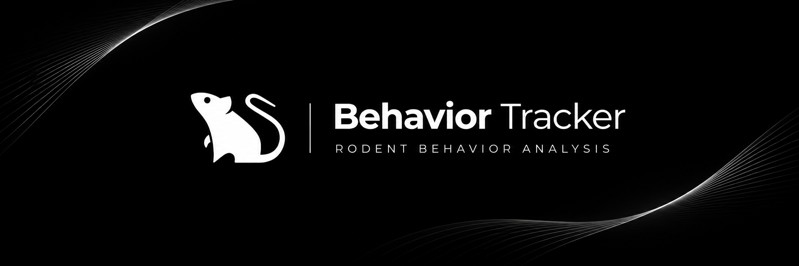

<p align="center">
  
</p>

# Behavior Tracker

Aplicativo desktop para análise de vídeos de **Campo Aberto** e **Nado Forçado** em roedores. A inferência é executada em um runtime Google Colab com GPU conectado à conta do pesquisador. Experimentos e resultados são mantidos no dispositivo.

Desenvolvido por **Gabriel Santos** e **Thiago Vargas**, em parceria entre o **Laboratório Neurocell** e o **NeuroLab da Universidade Federal de Pelotas (UFPel)**.

## Instalação e requisitos

- Use o instalador do aplicativo correspondente ao sistema: Windows x64 (`.exe`), macOS Intel ou Apple Silicon (`.dmg`), Linux x64 (`.deb` ou `.AppImage`). Quando publicada, a versão do aplicativo estará em [Releases](https://github.com/CodesOfGabriel/behaviortracker/releases). A release do bundle Wistar contém modelos, não um instalador.
- É necessária uma conta Google autorizada no projeto OAuth do aplicativo, com acesso ao Colab e a um runtime com GPU CUDA. A disponibilidade da GPU e as cotas dependem da conta.
- Os instaladores incluem `ffmpeg` e `ffprobe` para preparar vídeos localmente. Acima de 100 MB, o app remove o áudio e recodifica em H.264 com limite de 1080p; confere a quantidade e os tempos dos frames antes do envio. Se a cópia não for menor ou a verificação falhar, usa o original. O tamanho final depende do conteúdo do vídeo.
- Quando há redução de resolução, as marcações são convertidas para o vídeo enviado. No Campo Aberto, as coordenadas dos resultados voltam à escala original; no Nado Forçado, os arquivos da execução registram as duas resoluções e usam coordenadas do vídeo enviado.
- Guarde o vídeo original e uma cópia dos arquivos exportados. O aplicativo não sincroniza experimentos entre computadores.

## Procedimento

1. Abra o aplicativo e entre com a conta Google que será usada no Colab. No ícone do usuário, no rodapé da barra lateral, abra **Configurações** para registrar os dados do pesquisador e verificar a conexão. **Logoff** encerra a sessão Google neste dispositivo.
2. Em **Novo experimento**, escolha o protocolo, identifique os sujeitos e selecione um vídeo que o aplicativo consiga reproduzir.
3. Para **Campo Aberto**, marque os quatro cantos da borda superior e os quatro cantos do piso; informe as dimensões reais do piso em centímetros e a área central. Para **Nado Forçado**, delimite uma região fixa que cubra cada cilindro da abertura ao fundo.
4. Abra **Análise Completa** do experimento e selecione **Analisar no Colab**. Após a execução, confira o vídeo, os indicadores e os intervalos com dados insuficientes. Se houver várias execuções, selecione a que será interpretada e exporte seus arquivos.

## Protocolos e resultados

| Protocolo | Inferência | Resultados principais |
| --- | --- | --- |
| **Campo Aberto** | Bundle `wistar_df_v2`: detector Wistar D+F e DeepLabCut/HRNet com 27 pontos; método `oft-0.2`. | Trajetória, distância válida, velocidade, ocupação do centro e da periferia, cobertura temporal e MP4 de inspeção quando disponível. |
| **Nado Forçado** | DeepLabCut SuperAnimal Quadruped/HRNet com 39 pontos, para um ou dois animais em regiões fixas; método `fst-0.1`. | Presença, cobertura anatômica, movimento relativo, alteração de silhueta, intervalos com dados insuficientes e MP4 de inspeção quando disponível. |

No Campo Aberto, as medidas em centímetros usam a geometria do **piso**, enquanto a borda orienta o recorte visual enviado ao modelo. As exportações incluem `experiment.json`, `poses_raw.csv`, `poses_reviewed.csv`, `metrics.csv` e `corrections.jsonl`; `metrics_raw.csv` e o MP4 aparecem quando disponíveis. Coordenadas brutas e revisadas permanecem separadas.

No Nado Forçado, a presença visual e a confiança dos pontos anatômicos são registradas separadamente. O aplicativo **não classifica automaticamente** imobilidade, natação ou escalada: o campo de comportamento permanece `NOT_CLASSIFIED`. Os rótulos de comportamento são anotações humanas por intervalo e sujeito. As exportações da execução incluem poses, presença, atividade, caixas, manifesto e relatório; consulte o [contrato técnico do FST](docs/FST_CONTRACT.md) para os campos e arquivos.

## Interpretação e controle de qualidade

- Cobertura de pontos ou tempo válido indica disponibilidade de dados; **não mede acurácia anatômica**. Inspecione o MP4 e os frames relevantes antes de comparar grupos.
- No Campo Aberto, frames sem referência anatômica válida não são preenchidos para calcular distância ou velocidade. Métricas com baixa cobertura são parciais.
- Tempo no centro e imobilidade operacional são indicadores quantitativos; sua interpretação depende do protocolo e da revisão do vídeo.
- No Nado Forçado, presença incerta não equivale a ausência nem a imobilidade. Movimento e silhueta são indicadores observados para revisão, não rótulos comportamentais.
- Os indicadores ainda exigem validação com vídeos de referência e revisão manual de frames em execuções reais no Colab antes de fundamentar conclusões científicas.

## Publicação do site na VPS

O site em `behavior.usetars.com` é servido pelo Nginx de `docker-compose.live.yml`, com `dist/` montado em modo somente leitura. Um push na `main` dispara o workflow [`deploy-web.yml`](.github/workflows/deploy-web.yml), que testa e compila o site no GitHub Actions. O workflow envia o `dist/` pronto à VPS `vps-sala212`; o [`script de publicação`](scripts/deploy-live.sh) atualiza o checkout em `/srv/apps/behaviortracker` por avanço direto e troca a pasta publicada. A versão anterior é restaurada se as verificações HTTP locais falharem. A VPS não consulta o GitHub periodicamente.

O workflow usa o segredo de repositório `VPS_DEPLOY_SSH_KEY`, uma chave SSH dedicada ao usuário `deploy`. Configure esse segredo em **GitHub → Settings → Secrets and variables → Actions** antes do primeiro push com o workflow. A chave privada não deve entrar no Git; a chave pública do host está fixada em [`ops/behaviortracker-known-hosts`](ops/behaviortracker-known-hosts). Para consultar a última publicação na VPS:

```bash
cat /srv/apps/.behaviortracker-deploy/deployed_sha
docker ps --filter name=behaviortracker-web
```

O deploy do site é separado dos workflows de instaladores desktop, que continuam manuais.
