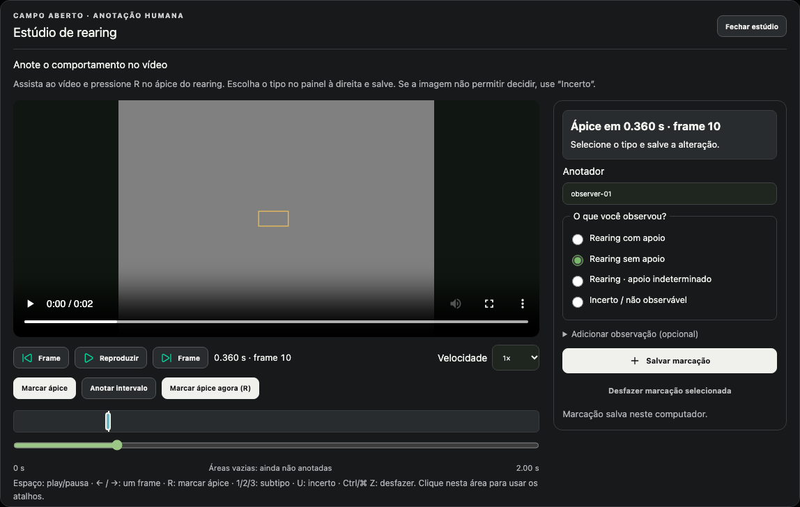

# Sincronização do vídeo e anotação do ápice de rearing

Data: 25/11/2026. Alterações locais; sem commit, instalação ou publicação.

## Comportamento implementado

A aba Detalhes usava `timeupdate` para escolher a caixa, deixando o overlay parado entre esses eventos durante a reprodução. `useVideoFrameTime` agora acompanha `requestVideoFrameCallback` e o `mediaTime` efetivamente apresentado. Navegadores sem essa API usam `requestAnimationFrame`. O estúdio usa `preload="auto"` para obter o primeiro frame sem exigir reprodução. No WebKit, o frame inicial zero já decodificado também inicializa o relógio quando o vídeo abre pausado sem callback nativo. A reprodução continua seguindo os callbacks de apresentação. Buscas invalidam o quadro anterior; buscas pausadas usam também `seeked`, pois buscar o mesmo frame pode não emitir outro callback de apresentação; callbacks de uma fonte anterior são descartados. A consulta usa os timestamps dos frames, inclusive VFR, sem manter caixas através de frames ausentes.

O estúdio abre no modo **Marcar ápice**. Durante a reprodução, **R** ou **Marcar ápice agora (R)** pausa, registra o frame apresentado e busca esse mesmo frame para conferência. Uma barra aparece imediatamente na timeline, ainda como rascunho. O painel à direita permite identificar o anotador, escolher o tipo e salvar. Clicar em uma barra salva permite alterar o tipo ou desfazer. A tentativa de criar outra marca não substitui um rascunho pendente. Falhas de gravação mantêm o rascunho disponível para nova tentativa.

O modo **Anotar intervalo** mantém início/fim, negativos e incertezas. Ápices são instantes: `PEAK` registra PTS e índice do frame; `LABEL_PEAK` altera o tipo por referência ao evento original; `UNDO` preserva o histórico. O backend rejeita frames/PTS inconsistentes, duplicatas ativas e edições de marcas desfeitas ou de outra execução. A gravação roda em `spawn_blocking`, fora da execução da interface.

`peaks.csv` exporta os pontos separadamente. O ZIP inclui `annotations/peaks.csv`, `intervals.csv` e o histórico completo; aceita sessões apenas com ápices. Nenhuma duração é inferida dos pontos. O pipeline atual de treinamento temporal continua exigindo intervalos completos.

Em telas de desktop, a altura do vídeo é limitada para manter a timeline e os controles principais visíveis. A geometria do overlay continua acompanhando a proporção do vídeo com letterboxing.

## Regressões

- Seleção de PTS VFR, limites de frames e perdas de tracking.
- Atualização por frame sem `timeupdate`, busca pausada, cancelamento de fontes antigas, fallback e inicialização pausada do WebKit.
- Captura por teclado durante reprodução, barra imediata, classificação, persistência ao reabrir, alteração de tipo, busca repetida do mesmo ápice com o vídeo pausado, exportação e desfazer.
- Falha de gravação com manutenção do rascunho e nova tentativa sem duplicação.
- Exportação ZIP com pontos, alterações e desfazer, sem fabricação de intervalos de treinamento.
- Visibilidade da timeline e do botão Salvar em 1180 × 760.

Os testes de interface executam o frontend de produção e decodificam um MP4 sintético no Chromium e no WebKit; somente a fronteira IPC do Tauri é simulada. Os testes Rust e Python verificam a validação e exportação separadamente. A barreira de pre-commit e CI inclui esses testes automaticamente.

## Limites

Não foi validada nesta etapa a aplicação instalada, nem a precisão espacial/biológica do tracking em um vídeo real do pesquisador. A sincronização da caixa corrige a apresentação; não treina um classificador de rearing. Anotações humanas e vídeos independentes continuam necessários para treinar e medir a precisão do modelo.

## Validação final

`npm run verify` concluiu com código 0 no macOS Intel após as correções de inicialização e busca pausada:

| Check | Resultado |
| --- | --- |
| Barreira de commit e workflows | 12 aprovados |
| Unitários e componentes | 187 aprovados, 30 arquivos |
| TypeScript da aplicação e dos testes | Aprovado |
| Build de produção | Aprovado |
| Interface Chromium/WebKit | 36 aprovados, sem retries |
| Registro de modelos | Aprovado |
| Python dos três protocolos | 211 testes, 1 skip específico de Windows |
| Scripts de preparação/validação | 13 aprovados |
| Rust e SQLite | 96 aprovados |

`core.hooksPath` está configurado como `.githooks`. Nenhum commit foi criado. CI remoto e instalador instalado não foram executados nesta validação.

## Captura da interface

Captura do teste em Chromium, 1180 × 760, com vídeo sintético cinza e caixas artificiais. Demonstra o fluxo da interface e a correspondência temporal; não contém observação biológica real.

## Correção posterior: identificador nas marcações consecutivas

O teste reproduziu o campo Anotador vazio ao tentar o terceiro ápice depois de fechar o estúdio, sair da aba Rearing e retornar. O identificador estava limitado ao estado do componente. Selecionar uma marca histórica também substituía o anotador atual pelo autor daquela marca.

O identificador agora é lembrado em `sessionStorage` durante a sessão da aplicação. A seleção de uma barra preserva o operador atual; novas alterações são atribuídas a ele, mantendo o autor original no histórico. Preencher o identificador remove imediatamente o aviso de campo obrigatório. Limpar o campo intencionalmente continua impedindo gravações sem identificação.

Os dois testes de componente para persistência e autoria e o teste de interface do terceiro ápice falharam antes da correção. Após a correção, `npm run verify:frontend` terminou com código 0: 12 testes da barreira/workflows, 190 unitários/componentes, TypeScript, build e 38 testes de interface. A nova regressão salva seis ápices em Chromium e WebKit, saindo e retornando à aba após o segundo e o quarto, e verifica os seis IDs, timestamps, barras e identificadores. Os três testes de componente também cobrem o aviso após limpar e preencher novamente o campo. Os testes de backend da validação anterior não foram repetidos nesta correção de frontend.
